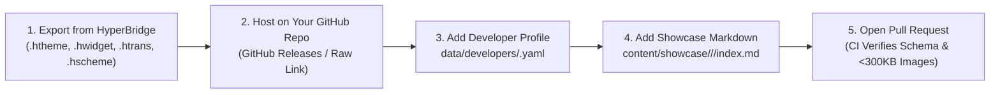

The **[HyperBridge Community Showcase](/showcase/)** is the official directory where users discover, filter, preview, and download community-built **Themes** (`.htheme` / `.hbt` / `.hbr`), **Studio Custom Designs** (`.hwidget`), **Smart Translators** (`.htrans` / `.hbp`), and **Material 3 Color Schemes** (`.hscheme`).

Because HyperBridge is **100% offline with zero internet permissions**, users browse the Showcase from the in-app **Design Hub** links or their browser, download your package directly, and tap the downloaded file to import it into HyperBridge via Android's local file association.

---

## 1. How the Submission Workflow Works



> [!IMPORTANT]
> **No Heavy Binary Files in the Website Repository:**  
> To keep the GitHub Pages site fast and lightweight, **never commit `.htheme`, `.hbt`, `.hbr`, `.htrans`, `.hbp`, `.hwidget`, `.apk`, or `.zip` archives into this repository**. Host your downloadable package file on your own GitHub Repository or GitHub Releases and point `download_url` to that URL. Our automated GitHub Action will reject any PR containing binary archives or images larger than **300 KB**.

---

## 2. Developer Profile Options (`data/developers/<username>.yaml`)

Every contributor gets a **Developer Profile** that appears in two formats across the Showcase:
- **Compact Developer Card (on Package Detail Pages)**: Displays your avatar logo, display name, role, badges, `@username` handle, total package count (`X pkgs`), and direct links to your **GitHub** and **Website**. Clicking anywhere on the card navigates to `/showcase/?dev=<username>` with your creator filter applied.
- **Full Developer Spotlight & Creators Directory (`/showcase/developers/`)**: Displays your full bio, contribution breakdown by category (Themes, Studio Designs, Translators, Color Schemes), and your featured GitHub repositories with descriptions.

Create or update `data/developers/<your-github-username>.yaml` (the filename **must** match the GitHub username opening the Pull Request):

```yaml
# Required: Must match your GitHub username and filename
id: "your-github-username"

# Required: Display name shown on cards, filters, and profile header
name: "Your Display Name"

# Recommended: Short title shown below your name (keep under 45 characters)
role: "Theme & Studio Widget Creator"

# Recommended: 1–2 sentence bio shown on the Creators directory & developer spotlight
bio: "Android & HyperOS enthusiast crafting minimal Super Island themes, media widgets, and app translators for HyperBridge."

# Optional: Defaults to https://github.com/<id>.png if omitted
avatar: "https://github.com/your-github-username.png"

# Optional: External profile links shown as action buttons on your Developer Card
github: "https://github.com/your-github-username"
website: "https://your-portfolio.dev"

# Recommended: Up to 3 repositories showcased on your full Developer Profile card
repos:
  - name: "My HyperBridge Customizations"
    url: "https://github.com/your-github-username/hyperbridge-packs"
    description: "Source files and releases for all my custom HyperBridge themes and translators"
  - name: "HyperOS Studio Widgets"
    url: "https://github.com/your-github-username/studio-widgets"
    description: "Collection of .hwidget micro-widgets designed in HyperBridge Studio"
```

| Field | Required | Recommendation |
|---|---|---|
| `id` | **Yes** | Your exact GitHub username (must match `<username>.yaml`). |
| `name` | **Yes** | Your full display name or handle (e.g., `"Alex Rivera"`). |
| `role` | Recommended | Concise specialty label (`25–45` characters) shown under your name. |
| `bio` | Recommended | Clear `120–240` character summary of what you build. Rendered in a full-width high-contrast callout on your profile card. |
| `avatar` | Optional | Direct HTTPS URL to your avatar (`https://github.com/<username>.png` is used automatically if omitted). |
| `github` | Recommended | Full URL to your GitHub profile (`https://github.com/<username>`). |
| `website` | Optional | Personal website, portfolio, or documentation URL (`https://...`). |
| `repos` | Optional | List of `{ name, url, description }` objects highlighting your repositories. |

> [!WARNING]
> **Profile Security Rules:**  
> - You may only create or edit `data/developers/<your-own-github-username>.yaml`. Modifying another developer's profile will fail CI validation.
> - Do **not** include `verified_maintainer: true` in your YAML — that flag is reserved for the core maintainer.

---

## 3. Banner Sizes, Optional Screenshots & Color Scheme Recommendations

### Banner & Image Sizing Specifications

| Image Field | Where It Appears | Container Behaviour | Recommended Size & Format |
|---|---|---|---|
| `preview_image` | **Showcase Card Banner** (`185px` fixed height) & **Detail Page Main Stage** (`320px` fixed height) | Cropped with `object-fit: cover` on grid cards; fitted in FULL with `object-fit: contain` + click-to-enlarge Lightbox on the detail page | **`1280×720px` (`16:9` landscape)** or **`1200×630px`**, `.webp` / `.jpg` / `.png`, **strictly `< 300 KB`** |
| `preview_compact` *(Optional)* | **Detail Page Thumbnail Switcher** (`Compact Pill` tab) | Adds a switcher button below the detail banner so users can toggle between Expanded and Compact Pill views | **`1280×720px`** or centered pill crop, **strictly `< 300 KB`** |
| `screenshots` *(Optional)* | **Detail Page Thumbnail Switcher** (`Screenshot 1`, `Screenshot 2`, …) | Adds additional thumbnail buttons on the detail page; clicking the main stage opens the full-screen Lightbox zoom | Any aspect ratio (`16:9` or phone capture), **strictly `< 300 KB` per file** |

> [!TIP]
> **When Are Screenshots Optional?**
> - **Single-Banner Packages**: Not every customization needs multiple screenshots! If you only provide `preview_image` (and omit `preview_compact` and `screenshots`), the detail page automatically hides the thumbnail switcher bar and displays your banner cleanly on its own.
> - **Color Schemes (`showcase_type: "scheme"`)**: Color schemes do **not** require island screenshots at all. Instead, you can specify your palette tokens using `specified_colors` (see below), and the detail page will render a dedicated **Specified Scheme Colors** swatch grid with token names and HEX codes.
> - **Card Click vs. Detail Page Zoom**: Clicking a card on `/showcase/` always opens the package's detail page directly. Full-screen Lightbox image zooming is active exclusively on the package detail page.

---

## 4. Writing Great Titles, Descriptions & Overviews

1. **Title (`title`)**:
   - Keep it clear and descriptive (`20–50` characters), e.g. `"Compact Wave Music Player"` or `"Smart OTP Auto-Copier"`.
   - On the package detail page, the **Title** and **Description** are showcased first at the very top of the page without badge clutter.
2. **Short Card Description (`description`)**:
   - Displayed directly below the title on both the **Showcase Grid Card** (clamped to **2 lines**) and the **Detail Page Header**.
   - **Recommended length**: **`90–150` characters** (1–2 crisp sentences explaining what the customization does and which apps or notification types it enhances).
3. **Detailed Markdown Body (`## Overview`)**:
   - Rendered in a full-width card directly below the scrollable badges strip (and below the color swatches on Color Schemes).
   - Include:
     - **Features & Visual Behavior**: How the collapsed pill and expanded island behave.
     - **Dynamic Variables / Rules Used**: Mention any Studio variables (`{title}`, `{subtext}`, `{progress}`) or translator extraction rules.
     - **Installation & Setup Notes**: Any recommended HyperBridge settings or companion app permissions.

---

## 5. Complete Frontmatter Reference

Place your package in the directory matching its `showcase_type`:
- **Themes**: `content/showcase/themes/<your-slug>/index.md`
- **Studio Custom Designs**: `content/showcase/designs/<your-slug>/index.md`
- **Custom Translators**: `content/showcase/translators/<your-slug>/index.md`
- **Color Schemes**: `content/showcase/schemes/<your-slug>/index.md`

### All Supported Frontmatter Fields

| Field | Required | Allowed Values / Type | Description |
|---|---|---|---|
| `title` | **Yes** | String | Package display name. |
| `description` | **Yes** | String (`90–150` chars recommended) | Short summary shown on the Showcase card (2 lines) and right under the detail page title. |
| `date` | **Yes** | `YYYY-MM-DD` | Publication or last-updated date (used for `Newest First` sorting). |
| `showcase_type` | **Yes** | `"theme"` \| `"design"` \| `"translator"` \| `"scheme"` | Primary category filter on `/showcase/`. |
| `file_extension` | **Yes** | `".htheme"` \| `".hbt"` \| `".hwidget"` \| `".htrans"` \| `".hbp"` \| `".hscheme"` | File format badge shown on download buttons and under the detail gallery. |
| `version` | **Yes** | SemVer String (e.g. `"1.2.0"`) | Package version number. |
| `min_app_version` | Optional | SemVer String (default `"0.6.0"`) | Minimum required HyperBridge app version. |
| `developer_id` | **Yes** | String | Must match your `data/developers/<id>.yaml` filename / GitHub username. |
| `repo_url` | **Yes** | HTTPS URL | Link to your public source repository on GitHub/GitLab/Codeberg. |
| `download_url` | **Yes** | HTTPS URL | Direct download link to your exported package file (e.g. GitHub Releases asset URL). |
| `license` | Optional | String (default `"MIT"`) | Open-source license identifier (`"MIT"`, `"Apache-2.0"`, `"GPL-3.0"`, `"CC-BY-4.0"`). |
| `target_scope` | **Yes** | `"GLOBAL"` \| `"SPECIFIC_APPS"` \| `"NOTIFICATION_TYPE"` \| `"SYSTEM_APPS"` | Populates the **Target Scope** sidebar filter and the compatibility column below the Overview. |
| `notification_types` | **Yes** | List of: `"MEDIA"`, `"MESSAGING"`, `"CALLS"`, `"NAVIGATION"`, `"PROGRESS"`, `"TIMER"`, `"STANDARD"` | Populates the **Notification Type** sidebar filter and compatibility rows. |
| `target_apps` | Optional | List of `{ name, package }` maps or Strings | Populates the **Target App** filter dropdown and compatibility rows (leave `[]` for global packages). |
| `canvas_size` | Optional | `"SMALL"` \| `"MEDIUM"` \| `"LARGE"` \| `"XLARGE"` | Studio canvas size or island layout preset shown in the compatibility column. |
| `template_base` | Optional | String (e.g. `"custom_studio"`, `"media_session"`) | Underlying template or translator engine identifier. |
| `preview_image` | Recommended | Relative filename or path | Primary `16:9` banner image (`< 300 KB`). |
| `preview_compact` | Optional | Relative filename or path | Optional second image for the Compact Pill view (`< 300 KB`). |
| `screenshots` | Optional | List of filenames/paths | Optional extra gallery images (`< 300 KB` each). |
| `specified_colors` | Optional (`scheme` only) | List of `{ name, hex }` maps or HEX strings | **For Color Schemes (`showcase_type: "scheme"`) only:** renders the **Specified Scheme Colors** swatch cards on the detail page. |
| `accent_colors` | Optional | List of HEX strings (e.g. `["#38BDF8", "#6366F1"]`) | Used as the fallback card banner accent color if no `preview_image` is provided. |
| `tags` | Optional | List of lowercase strings | Searchable keywords and `#tag` pills shown in the scrollable badges strip under the detail image. |

---

### Template A: Theme, Studio Design, or Translator (`index.md`)

```yaml
---
title: "My Awesome Spotify Island"
description: "Expressive waveform media player for Spotify and YouTube Music with dynamic album art tinting and 1-tap playback controls."
date: 2026-10-16

# 1. Classification ("theme" | "design" | "translator" | "scheme")
showcase_type: "design"
file_extension: ".hwidget"
version: "1.0.0"
min_app_version: "0.6.0"

# 2. Developer ID (Must match data/developers/<your-github-username>.yaml)
developer_id: "your-github-username"

# 3. Repository & Direct Download Link
repo_url: "https://github.com/your-github-username/hyperbridge-packs"
download_url: "https://github.com/your-github-username/hyperbridge-packs/releases/latest/download/spotify_island.hwidget"
license: "MIT"

# 4. Filter & Compatibility Metadata
target_scope: "SPECIFIC_APPS" # GLOBAL | SPECIFIC_APPS | NOTIFICATION_TYPE | SYSTEM_APPS
notification_types:           # MEDIA | MESSAGING | CALLS | NAVIGATION | PROGRESS | TIMER | STANDARD
  - "MEDIA"
target_apps:
  - name: "Spotify"
    package: "com.spotify.music"
  - name: "YouTube Music"
    package: "com.google.android.apps.youtube.music"
canvas_size: "MEDIUM"
template_base: "custom_studio"

# 5. Visuals (1280x720px 16:9 banner recommended, < 300 KB each)
# Note: preview_compact and screenshots are optional! Omit them if you only have a single banner.
preview_image: "preview.webp"
preview_compact: "preview-pill.webp"
screenshots:
  - "screenshot-expanded.webp"
accent_colors:
  - "#1DB954"
  - "#18181B"
tags:
  - "spotify"
  - "music"
  - "studio"
  - "waveform"
---

## Overview

Explain what your customization does, how it looks in both collapsed and expanded states, and any special variables or rules it uses.

### Key Features
- **Dynamic Album Tint**: Automatically adapts border glow to the current track cover.
- **Interactive Seek Bar**: Full track progress bar with elapsed and remaining timestamps.
```

---

### Template B: Color Scheme (`content/showcase/schemes/<slug>/index.md`)

For **Color Schemes** (`showcase_type: "scheme"`), you only need a single banner (or fallback) and can share your palette tokens using `specified_colors`:

```yaml
---
title: "Material Expressive Ocean (.hscheme)"
description: "Deep ocean cyan-to-indigo Material 3 color scheme for Studio micro-widgets with full dark and light tonal surface definitions."
date: 2026-10-16

showcase_type: "scheme"
file_extension: ".hscheme"
version: "1.0.0"
min_app_version: "0.6.0"

developer_id: "your-github-username"
repo_url: "https://github.com/your-github-username/hyperbridge-packs"
download_url: "https://github.com/your-github-username/hyperbridge-packs/releases/latest/download/ocean.hscheme"
license: "MIT"

target_scope: "GLOBAL"
notification_types:
  - "MEDIA"
  - "STANDARD"
target_apps: []

# Single banner is sufficient for Color Schemes (no compact pill screenshot required)
preview_image: "banner.webp"

# Share your scheme's key color tokens (rendered as visual swatch cards on the detail page)
specified_colors:
  - name: "Primary Cyan"
    hex: "#38BDF8"
  - name: "Ocean Secondary"
    hex: "#0284C7"
  - name: "Expressive Tertiary"
    hex: "#818CF8"
  - name: "Deep Surface"
    hex: "#0F172A"
  - name: "Container Highlight"
    hex: "#1E293B"

tags:
  - "color-scheme"
  - "material-3"
  - "ocean"
  - "yaml"
---

## Overview

Describe the tonal palette, contrast ratios, and which types of Studio widgets or Themes pair best with your color scheme.
```

---

## 6. Recognition Badges & Automated Community Voting

Users can filter the Showcase using a **multi-select Recognition checklist** for four official badges. On the package detail page, all earned badges and `#tags` appear in a horizontal scrollable strip directly beneath your banner image:

| Badge | ID | How It Is Earned |
|---|---|---|
| **🛡️ Developer Approved** | `dev_approved` | Awarded directly by `@D4vidDf` after reviewing your package for visual polish, rule accuracy, and safety. |
| **❤️ Community Choice** | `community_approved` | **Awarded Automatically!** When your package reaches the community like/star threshold (**15+ votes/stars**), our scheduled GitHub Action automatically grants the Community Choice badge. |
| **🎬 Featured in Media** | `featured_media` | Awarded when your customization is showcased in a YouTube video, review, or tech article (adds a **Showcased in Media** box with clickable links on your detail page). Mention any media links in your PR! |
| **⭐ Official Preset** | `official` | Reserved for built-in presets maintained by the HyperBridge core team. |

> [!WARNING]
> **Protected Badge Registry (`data/showcase_badges.json`):**  
> Curation badges and vote counts are stored centrally in `data/showcase_badges.json` and protected by `.github/workflows/validate-showcase-pr.yml` and `CODEOWNERS`. **Never** add `badges:`, `votes:`, or `media_features:` to your Markdown frontmatter or edit `data/showcase_badges.json` in a third-party Pull Request, or the automated security check will block the PR.
