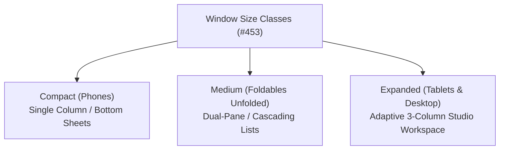
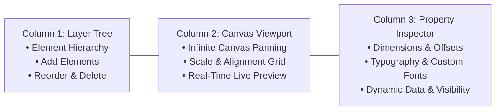

Starting in **HyperBridge v0.6.0**, the app introduces a major redesign built specifically for large displays, foldable smartphones, and desktop desktop/Workstation modes. 

Instead of merely stretching a mobile phone layout across wide viewports, HyperBridge natively adapts its workspaces using modern **Window Size Class** standards ([#453](https://github.com/D4vidDf/HyperBridge/pull/453)).

---

## 🖥️ Adaptive 3-Column Widget Studio (#456)

When using **Widget Studio** on a tablet (such as Xiaomi Pad 6, Xiaomi Pad 7 Pro, or Redmi Pad) or an unfolded foldable (such as Xiaomi MIX Fold 3 / 4), the workspace automatically transitions from a stacked vertical layout into a full **3-Column Creative Studio**:

### 1. Left Column: Layer Tree & Hierarchy
- Displays a clean tree view of all elements placed on your widget canvas (Containers, Texts, Images, Progress Bars, Buttons, and Shapes).
- Allows 1-tap selection, drag-and-drop layer reordering, and element deletion without covering the canvas.

### 2. Center Column: Canvas Viewport with Panning
- **Fluid Viewport & Infinite Canvas Panning**: Drag across the canvas area to pan around complex layouts without being restricted by screen borders.
- **Dynamic Scenario Switcher**: Switch between Expanded Island (Heads-up) and Compact Pill modes on the fly.
- **High-Fidelity Live Preview**: Changes made in the inspector render instantly on the canvas with exact typography, color schemes, and picture masks.

### 3. Right Column: Contextual Property Inspector
- Dynamically updates based on the currently selected layer:
  - **Containers**: Background colors, corner radiuses, borders, and per-container color scheme overrides.
  - **Typography**: Text formulas, font size, alignment, and custom imported TTF/OTF typefaces.
  - **Formulas & Conditions**: Real-time evaluation of `{token}` expressions and visibility rules (`showIf`).

---

## 🎨 Split-Pane & Cascading Panes in Theme Creator (#455)

Editing complex themes with dozens of Material 3 color tokens can quickly become disorienting on small single-column interfaces.

On large screens, **Theme Creator** automatically organizes into a **Split-Pane Architecture**:
- **Master Configuration Pane (Left)**: Inspect overall theme metadata, primary accents, background palettes, and active Island previews.
- **Cascading Detail Pane (Right)**: Tapping into sub-categories (such as Call Config, Default Action Buttons, Progress Icons, or App Overrides) opens cascading secondary panes alongside the main theme rather than replacing it. You can adjust colors or test geometric masks while continuously referencing the master preview.

---

## ⚡ Adaptive Translator Experience (#460)

The **Custom Translator Editor** features an adaptive dual-pane experience with cascading navigation:
- **Left Pane**: Displays your translator list, evaluation priorities, condition filters, and target application packages.
- **Right Pane**: Houses dynamic variable extraction rules, action slot builders, and behavioral override switches (`Float only on first alert`, `Show on lock screen`).
- Makes string localization, regex testing, and action assignment significantly faster without constant back-and-forth navigation.

---

## 📱 Supported Devices & Form Factors

HyperBridge's responsive adaptive layouts are thoroughly optimized for:
- **Xiaomi Pad Series**: Xiaomi Pad 5, Pad 6 / 6 Pro / 6S Pro, Xiaomi Pad 7 series, and Redmi Pad Pro.
- **Foldables**: Xiaomi MIX Fold series (MIX Fold 2, 3, 4) in both folded (outer screen) and unfolded (inner screen) postures, as well as Xiaomi MIX Flip.
- **HyperOS Workstation Mode & DeX**: When connecting your Xiaomi phone or tablet to an external display, HyperBridge renders in full landscape windowed mode.

---

## 🔗 Related Guides

- **[Widget Studio Overview]()**: Deep dive into the element builder.
- **[Visual Theme Creator]()**: Building and packaging `.htheme` visual styles.
- **[Custom Translators Guide]()**: Writing declarative notification transformation rules.
