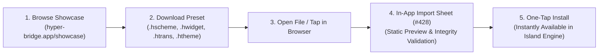

The **[HyperBridge Community Showcase](https://hyper-bridge.app/showcase/)** is the official community hub for discovering, downloading, and sharing custom HyperIsland creations. 

Whether you want vibrant Material 3 color schemes, YouTube Music-style player widgets, or specialized messaging translators, the Showcase allows you to personalize your dynamic island experience in just a few taps.

---

## 🌟 What Can You Find on the Showcase?

The showcase features four distinct categories of community-crafted assets:

| Asset Type | Extension | Description |
|---|---|---|
| **Color Schemes** | `.hscheme` | Standalone Material 3 YAML color palettes (such as *La Coruña Total Eclipse*, *Retro Tech*, or *Silksong: Sea of Sorrow*). |
| **Widget Designs** | `.hwidget` | Spatial micro-widgets built with Widget Studio, complete with dynamic layouts, progress arcs, and container styles. |
| **Custom Translators** | `.htrans` | Specialized notification transformation rules, dynamic regex variable extractors, and custom action buttons (e.g. *Musicrama*). |
| **Full Themes** | `.htheme` / `.hbr` | Comprehensive theme packs bundling custom icon masks, call buttons, progress assets, and linked translators. |

---

## 📱 In-App Showcase Integration (#427)

Starting in **HyperBridge v0.6.0**, you don't even have to open a browser manually to find trending presets:

- **Featured Banner Cards**: The hero carousel on the **Design Hub** (`DesignScreen`) highlights trending community creations and official presets.
- **Direct Deep Links**: Tapping any featured banner instantly launches the corresponding showcase entry on [hyper-bridge.app/showcase](https://hyper-bridge.app/showcase/), allowing you to inspect design screenshots, author notes, and version history.

---

## 📥 How to Download and Import Presets

### Step 1: Browse & Download
1. Visit the **[Official Community Showcase](https://hyper-bridge.app/showcase/)** on your Xiaomi device.
2. Filter by category (e.g., **Color Schemes** or **Designs**).
3. Tap on any item to view its details, expanded island preview, and compact pill preview.
4. Tap the **Download Preset** button. Your browser will download the preset file (e.g., `Musicrama.htrans` or `coruna_solar_eclipse.hscheme`).

### Step 2: In-App File-Association Import Modal (#428)
HyperBridge registers native Android file associations for `.hscheme`, `.hwidget`, `.htrans`, `.htheme`, and `.hbr`:

1. Tap the downloaded file in your browser's download manager, or open it from your favorite file manager (such as *Files by Google* or *MiXplorer*).
2. Android will automatically prompt to open the file with **HyperBridge**.
3. HyperBridge launches and presents the **Redesigned Import Bottom Sheet** ([#428](https://github.com/D4vidDf/HyperBridge/pull/428)):
   - **Static Live Preview**: Renders a high-fidelity visual preview of the design, colors, or icons before you accept.
   - **Package Validation**: Inspects the package manifest, author information, and schema version to verify integrity.
   - **Export & Import Selectors**: If a widget design comes bundled with a linked custom translator (or vice versa), the selector allows you to import both the visual design and its underlying translation rules simultaneously.
4. Tap **Import**. The preset is instantly verified, saved to your local library, and ready to apply.


**Tip for Chrome & Chromium Users:** If your browser saves files with a `.zip` extension instead of `.hwidget` or `.htrans`, simply rename the downloaded file back to its original extension before opening it.


---

## 📤 Sharing Your Own Creations (#428, #429)

Built an awesome widget or color scheme in Widget Studio? Sharing it with the community is quick and seamless:

1. Open **HyperBridge** and navigate to the **Design** tab.
2. In the Design Manager, Theme Manager, or Translator Manager, locate your custom item.
3. Tap the **overflow menu (⋮)** on the card ([#429](https://github.com/D4vidDf/HyperBridge/pull/429)).
4. Tap **Share / Export**:
   - The upgraded **Share Bottom Sheet** ([#428](https://github.com/D4vidDf/HyperBridge/pull/428)) generates a preview and gives you the option to bundle any linked translators or theme overrides.
   - HyperBridge exports a standardized file (`.hwidget`, `.hscheme`, or `.htrans`) directly to your device storage or shares it via Android's system share sheet.
5. Follow our **[Showcase Submission Guide]()** to submit a pull request and feature your creation in the official Showcase!

---

## 🔗 Related Resources

- **[Showcase Submission Guide]()**: How to submit your designs to the community repository.
- **[Design Hub & Studio]()**: In-app creative control center.
- **[Color Schemes & Dynamic Palettes]()**: Material 3 color roles and authoring.
- **[Theme & Color Scheme Packaging Specification]()**: Technical file structure and schema rules.
