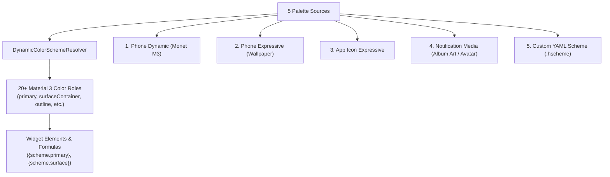

Starting with **Hyper Bridge 0.6.0-beta4**, the custom widget engine features a full **Material 3 Dynamic Color Architecture** (`DynamicColorSchemeResolver`).

Instead of hardcoding static hex colors into your widgets, you can now bind visual elements to semantic color roles. Widgets can adapt automatically to your wallpaper, the notifying app's launcher icon, or album artwork—or follow a custom YAML color palette you create!



---

## 1. The 5 Palette Sources

In the Studio's **Global** tab (or when configuring a color property), you can choose how your widget resolves its color palette:

### 1. Phone Dynamic (Monet M3)
Draws tonal palettes directly from Android's system Material You (Monet) engine. When you change your phone's system theme or wallpaper accent, your island widget smoothly reflects the new system colors.

### 2. Phone Expressive (Dynamic M3)
Synthesizes a high-contrast, expressive tonal palette generated from your active desktop wallpaper.

### 3. App Icon Expressive
Extracts vibrant seed colors directly from the application icon that generated the notification.
- Spotify notifications adopt Spotify's vibrant green.
- YouTube notifications shift to bold red accents.
- Telegram cards tint in vivid sky blue.

### 4. Notification Media Expressive
Extracts color palettes on the fly from incoming image attachments:
- **Album Art / Large Media**: Music player islands dynamically tint to match the playing album cover.
- **Picture Attachment**: Photo sharing and messaging notifications adapt to image previews.
- **Sender Avatar**: Direct chat islands pull seed colors from the contact's profile photo.

### 5. Custom YAML Scheme
Applies a custom creator-defined palette file (`.hscheme`) or one of Hyper Bridge's built-in curated presets:
- **HyperOS Classic**: HyperOS electric blue accent (`#0A84FF`).
- **Emerald Mint**: Fresh vibrant emerald (`#10B981`).
- **Sunset Orange**: Warm neon orange (`#FF5722`).
- **Ocean Breeze**: Deep cyan & turquoise (`#00BCD4`).
- **Neon Violet**: Vivid purple (`#8B5CF6`).
- **Monochrome**: Minimalist grayscale tonal palette (`#9E9E9E`).

---

## 2. Material 3 Standard Color Roles

Hyper Bridge maps 20+ standard Material 3 color roles. You can reference any of these in text, backgrounds, buttons, and progress bars:

| Token Key | Role Name | Intended Usage |
|---|---|---|
| `primary` | **Primary** | High-emphasis accent: progress fill, key buttons, important badges. |
| `on_primary` | **On Primary** | Text or icons rendered on top of `primary` backgrounds. |
| `primary_container` | **Primary Container** | Soft accent fill for card highlights and secondary badges. |
| `on_primary_container` | **On Primary Container** | Typography rendered on top of `primary_container`. |
| `secondary` | **Secondary** | Secondary accents, status pill dots, and minor action triggers. |
| `on_secondary` | **On Secondary** | Contrast color for elements on `secondary` fills. |
| `tertiary` | **Tertiary** | Contrasting visual accent for timestamps, alerts, or tags. |
| `surface` | **Surface** | Main background fill for cards and containers. |
| `on_surface` | **On Surface** | Primary text color for titles and headlines. |
| `surface_variant` | **Surface Variant** | Subtitle text, divider lines, and subtle containers. |
| `on_surface_variant` | **On Surface Variant** | Secondary body copy and metadata timestamps. |
| `surface_container` | **Surface Container** | Standard elevated background for nested cards and rows. |
| `surface_container_high`| **Surface Container High** | Elevated button backgrounds and popups. |
| `surface_container_low` | **Surface Container Low** | Recessed backplates and track grooves. |
| `outline` | **Outline** | Stroke borders for buttons, shapes, and dividers. |
| `outline_variant` | **Outline Variant** | Subtle secondary borders. |
| `error` | **Error** | Critical warnings, low battery badges, and decline actions. |
| `on_error` | **On Error** | Text rendered over error backgrounds. |

---

## 3. Authoring YAML Color Schemes (`.hscheme`)

Hyper Bridge uses a clean, human-readable YAML specification for color schemes (`YamlColorSchemeParser`). You can write these files in any text editor and import them into the app.

### File Format Specification

A color scheme file must use the extension `.yaml`, `.yml`, or `.hscheme`:

```yaml
id: sunset_neon
name: Sunset Neon
author: HyperCreator
description: Vibrant warm neon palette for night owls
is_dark: true

roles:
  primary: "#FF5E3A"
  on_primary: "#FFFFFF"
  primary_container: "#5C1500"
  on_primary_container: "#FFDBCF"
  secondary: "#FF9500"
  on_secondary: "#000000"
  secondary_container: "#4B2800"
  on_secondary_container: "#FFDCBE"
  tertiary: "#FF2A6D"
  on_tertiary: "#FFFFFF"
  surface: "#141112"
  on_surface: "#EDE0DE"
  surface_variant: "#251D1F"
  on_surface_variant: "#D7C1BD"
  surface_container: "#1E1819"
  surface_container_high: "#2B2224"
  surface_container_low: "#181314"
  outline: "#9F8C88"
  outline_variant: "#524341"
  error: "#FFB4AB"
  on_error: "#690005"
```

### Hex Color Formatting Rules
- Hex codes may be 6 digits (`#RRGGBB`), 8 digits (`#AARRGGBB` with opacity), or 3 digits (`#RGB`).
- Unspecified roles automatically fall back to synthesized tonal values based on `primary`.

---

## 4. The Studio Color Picker (`StudioColorField`)

Whenever you edit a color in the Studio (e.g. text color, button background, container fill), tapping the color chip opens the **Color Scheme Picker Sheet**:

```text
┌────────────────────────────────────────────────────────┐
│ Select Color                                           │
├────────────────────────────────────────────────────────┤
│ [ Color Scheme Tokens ]       [ Custom Hex Color ]     │
├────────────────────────────────────────────────────────┤
│ Quick Roles:                                           │
│  [ Primary       ■ #FF5E3A ]  [ Secondary    ■ #FF9500 ]│
│  [ Surface       ■ #141112 ]  [ Error        ■ #FFB4AB ]│
│                                                        │
│ All Material 3 Roles:                                  │
│  ● Primary Container          ■ #5C1500               │
│  ● On Surface Variant         ■ #D7C1BD               │
│  ● Surface Container High     ■ #2B2224               │
└────────────────────────────────────────────────────────┘
```

- **Color Scheme Tokens Tab**: Select any semantic role (`@scheme:primary`). Your element will automatically update if the user swaps themes or wallpapers!
- **Custom Hex Color Tab**: Use a color wheel, RGB sliders, or direct hex input (`#38BDF8`) for fixed, non-adaptive styling.

---

## 5. In-App Scheme Management & YAML Import/Export

The **Global** tab of the Studio gives you full control over palette persistence:

- **Import Palette (YAML)**: Tap **Import Palette** to select any `.hscheme` or `.yaml` file from your device storage. Hyper Bridge parses and validates the roles immediately.
- **Export Palette (YAML)**: Tap **Export Palette** to serialize your current colors into clean YAML and share them with other users.
- **Embed in Design (`embeddedColorSchemeYaml`)**: When enabled, the full YAML color scheme is saved directly inside your `widget.json` file. When you share the widget as a `.hwidget`, recipients get your custom color palette without needing to install separate scheme files!

---

## What's Next in the Series?

Now that your widget looks stunning and adapts to color roles, proceed to the final part of the series to learn how `.hwidget` packages are structured, how to export and share them, and how to handcraft widget files from scratch:

👉 **[Part 5: Packaging, Sharing & Handcrafting .hwidget Files]()**
