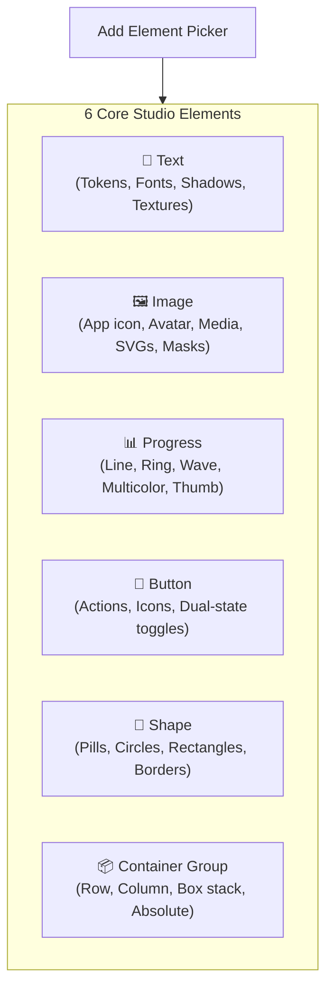

Every design built in the **Micro-Widgets Studio** is composed of an Abstract Syntax Tree (AST) of visual nodes (`CustomWidgetNode`). When compiled, Hyper Bridge maps these elements into optimized Android RemoteViews compatible with Xiaomi HyperOS HyperIsland.

To add an element to your design:
1. Tap the **`+` (Add)** button in the **Items** tab or the canvas breadcrumb.
2. The **Add Element Screen** will open with the 6 core building block options.
3. Select an element to place it into the selected container group.



---

## 1. Text Element (`TextNode`)

The **Text** element renders static strings or dynamic notification templates (`{notif.title}`, `{media.track}`).

### Inspector Tabs for Text
- **Info Tab**: Layer label, text template string, font family, max lines, marquee, sizing type, and alignment.
- **Colors Tab**: Text color hex (or semantic color scheme token), opacity slider.
- **EFX Tab**: Text shadows, background blur masks, and gradient or bitmap textures.
- **Position Tab**: X / Y coordinates, width, height, and rotation stepper.
- **Visibility Tab**: Conditional display rules (`showIf`).

### Key Properties

| Property | Options | Description |
|---|---|---|
| **Template / Content** | Dynamic string | The text to display. Supports all `{tokens}` (e.g., `{notif.title} • {device.battery}%`). |
| **Font Family** | `Default`, `Sans-Serif`, `Serif`, `Monospace`, `Cursive`, `Casual`, `Condensed` | System typography styling. |
| **Sizing Type** | `Fixed Font Height`, `Fit Width`, `Fixed Width`, `Fit Box` | **Fixed Font Height**: Set a fixed `fontSizeSp` (e.g., 14sp).<br>**Fit Width**: Scales text to fill container width.<br>**Fit Box**: Scales text uniformly to fit bounding box. |
| **Max Lines & Marquee** | Integer & Toggle | Restrict text to 1, 2, or more lines. When **Marquee** is enabled on a single-line element, overflowing text scrolls continuously. |
| **Gravity / Alignment** | `Start`, `Center`, `End` | Horizontal alignment within the element's bounding box. |
| **Filter & Blend Modes** | 11 modes (`Normal`, `Multiply`, `Screen`, `Overlay`, `Darken`, `Lighten`, `Add`, etc.) | Blends the text rendering with layers beneath it. |

### Text Effects (`TextEfxConfig`)
- **Drop Shadows**: Configure blur radius (dp), light angle direction (0–360°), projection distance, and shadow color (with alpha).
- **Background Blur Mask**: Adds a Gaussian background blur underneath the text glyphs for legibility against complex notification covers.
- **Textures**: Apply horizontal, vertical, radial, sweep gradients, or custom bitmap fills inside the typography itself!

---

## 2. Image Element (`ImageNode`)

The **Image** element displays graphics, app badges, contact avatars, media album art, and custom assets.

### Image Sources (`ImageSource`)

| Source Mode | Template / Parameter | Description |
|---|---|---|
| **App Icon** | `app_icon` (`{notif.package}`) | Displays the official launcher icon of the app that posted the notification. |
| **Contact Avatar** | `contact_avatar` (`{notif.title}`) | Resolves the sender's contact avatar or initials from the device contact provider. |
| **Notification Media** | `notif_media` (`avatar`, `picture`, `album_art`) | Direct bitmap extracted from notification attachments (chat photos, messaging avatars, or playback art). |
| **Custom Asset** | `custom_asset` (`filename.png`) | Loads a bundled image file stored inside the widget's own `assets/` directory. |
| **System Glyph** | `system_glyph` (`name`) | Built-in system symbols (e.g., `battery`, `wifi`, `volume`, `notification`). |
| **Content Source Icon**| `source_icon` (`sourceId`) | Dynamic icon provided by an external data plugin via `UPDATE_SOURCE`. |

### Shape Masking & Styling
- **Geometric Shapes**: Mask the image into `circle`, `rounded_rect`, `cookie`, `squircle`, or `pill` with a custom corner radius stepper.
- **Format Mode**: Select between `Bitmap` (raster) and `SVG` (scalable vector graphics).
- **Scaling (`ImageScaleType`)**: `Fit Width`, `Fit Height`, `Fit Center`, or `Center Crop`.
- **Blur & Attenuation**: Apply real-time blur to album covers for ambient background cards.
- **Tinting**: Optional color hex overlay to tint monochrome glyphs with theme accent colors.

---

## 3. Progress Element (`ProgressNode`)

The **Progress** element displays real-time progress for downloads, media playback, battery level, or delivery tracking.

### Indicator Modes & Styles

```text
Linear Line:     [████████████░░░░░░░░░░░░░░░░]  (Line mode, Linear style)
Divided Steps:   [████]  [████]  [████]  [░░░░]  (Divided mode)
Waveform:        [∿∿∿∿∿∿∿∿∿∿∿∿~~~~~~~~~~~~~~~~]  (Wave mode, Dynamic canvas)
Circular Ring:       ╭─────╮                     (Circle mode, Ring style)
                    │  75% │
                     ╰─────╯
```

1. **Line (`ProgressIndicatorMode.LINE`)**: Traditional continuous progress bar.
2. **Circle / Ring (`ProgressIndicatorMode.CIRCLE`)**: Compact circular gauge ideal for pills and quick status badges.
3. **Divided (`ProgressIndicatorMode.DIVIDED`)**: Segmented milestone blocks (e.g., multi-stage delivery routes).
4. **Wave (`ProgressIndicatorMode.WAVE`)**: An animated organic wave bar powered by `WavyProgressCanvas`, perfect for music and audio playback.

### Color Modes (`ProgressColorMode`)
- **Flat**: Single accent color across the entire active fill.
- **Gradient**: Two-point linear blend between a start color and `gradientEndColorHex`.
- **Current**: Automatically adopts system Material You accent colors.
- **Multicolor**: Threshold array (e.g., Green for battery > 50%, Orange for 20–50%, Red for < 20%).

### Thumb Indicators
Choose between `None`, `Rounded` (circular slider knob), or `Custom Pic` (a miniature icon or graphic moving along the progress track).

---

## 4. Button Element (`ButtonNode`)

The **Button** element turns your micro-widget into an interactive command center. Buttons can fire intents, dismiss cards, dispatch broadcasts, or control media playback.

### Button Action Types (`ButtonAction`)

| Action Type | Parameter | Behavior |
|---|---|---|
| **Notification Action** | `index` (0, 1, 2...) | Triggers the original notification's native action button at the specified index. |
| **Dismiss** | *None* | Dismisses the current notification and hides the island card. |
| **Inline Reply** | *None* | Opens Hyper Bridge's native floating quick-reply dialog for messaging apps. |
| **Open App** | `packageName` | Directly launches the target application via Intent. |
| **Deep Link** | `uri` | Dispatches an `ACTION_VIEW` intent with a web URL or custom app scheme. |
| **Smart Action** | `type` (`OTP`, `URL`, `PHONE`, `TRACKING`) | Executes an automated action detected by HyperBridge (e.g., copies OTP code to clipboard). |
| **Broadcast** | `action`, `package`, extras | Sends a custom explicit/implicit Android broadcast to integrate with Tasker, Automate, or personal apps. |
| **Media Control** | `command` (`play_pause`, `next`, `previous`, `stop`) | Dispatches a transport control command to the active `MediaSession`. |

### Icon & Sub-Icon Layout
Configure primary icons and secondary badge icons, positioned as `Leading`, `Trailing`, `Icon Only`, or `Top`.

### Dual-State Conditional Overrides
Buttons can dynamically switch their appearance based on runtime conditions without needing two separate elements!
For example, for a Media Play/Pause button:
- **Default State**: Label `"Play"`, Icon `play_arrow`, Action `MediaControl("play")`.
- **Conditional State**: When condition is `is_media_playing`, automatically swaps label to `"Pause"`, icon to `pause`, and action to `MediaControl("pause")`.

---

## 5. Shape Element (`ShapeNode`)

The **Shape** element renders vector primitive geometry:
- **Shape Geometries**: `circle`, `rectangle`, `rounded_rect`, `pill`.
- **Customizable Styling**: Fill color, stroke color, border stroke width (dp), and corner radius.
- Use shapes as badge backgrounds, dividing lines, tinted photo backplates, or status dot indicators.

---

## 6. Container Group Element (`LayoutContainer`)

Containers organize elements into structured layouts. Every micro-widget has a root container (`root`) and can contain nested groups.

### Layout Flow Modes (`ContainerLayout`)

```text
ROW:       [ Item 1 ] [ Item 2 ] [ Item 3 ]    (Horizontal flow)

COLUMN:    ┌──────────────┐
           │   Item 1     │
           │   Item 2     │                    (Vertical flow)
           │   Item 3     │
           └──────────────┘

BOX:       ┌──────────────────────────────┐
           │ Layer 3 (Top)                │    (Z-stack layering:
           │   Layer 2 (Middle)           │     children drawn on top
           │     Layer 1 (Bottom)         │     of each other)
           └──────────────────────────────┘

ABSOLUTE:  (Canvas freeform coordinates: each element uses explicit X and Y)
```

- **Gap (dp)**: Uniform spacing between items in Row and Column layouts.
- **Padding (dp)**: Inset margin applied inside container boundaries.
- **Backgrounds**: Solid color fill or **Picture Background** (loading album art, wallpapers, or bundled assets with optional blur).

---

## 7. Common Node Properties Across All Elements

Every element in the Studio shares these foundational properties:

- **Position & Dimensions**:
  - `x`, `y` offsets in dp (used in Box and Absolute containers).
  - `widthDp`, `heightDp` explicit dimensions.
  - `rotation`: Freeform rotation angle (-180° to +180°).
- **Stack Layer Ordering**:
  - Elements listed lower in the tree or layer panel draw on top of elements above them.
  - Use **Bring Forward** and **Send Back** in the Position tab to adjust z-index.
- **Canvas Lock Toggle**:
  - Tap the lock icon to prevent accidental dragging or resizing when selecting items on the canvas.
- **Opacity Stepper**:
  - Adjust opacity from `0.0` (invisible) to `1.0` (fully opaque).
- **Conditional Visibility (`showIf`)**:
  - Control when the element is rendered (covered in Part 3).

---

## What's Next in the Series?

Now that you know how each element works, proceed to **Part 3** to learn how to wire dynamic notification variables, write formulas, and set up conditional visibility:

👉 **[Part 3: Formulas, Dynamic Data & Visibility Conditions]()**
