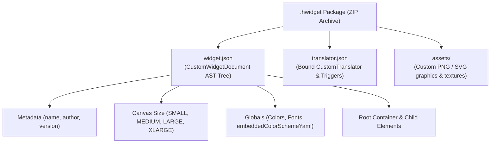

Every design created in Hyper Bridge can be packaged, backed up, and shared across devices as a standalone **`.hwidget`** file.

Under the hood, a `.hwidget` file is a standard ZIP archive containing the widget's structural tree (`widget.json`), its notification binding rules (`translator.json`), and any embedded image or vector graphics (`assets/`).



---

## 1. Anatomy of a `.hwidget` Package

If you rename a `.hwidget` file to `.zip` and extract it, you will find the following clean structure:

```text
my_awesome_widget.hwidget/
├── widget.json          # Complete AST layout and element definition
├── translator.json      # Interceptor rules, notification triggers, and pill styling
└── assets/              # Optional local graphics referenced in ImageNode
    ├── logo.png
    ├── background_pattern.png
    └── verified_badge.svg
```

### The `widget.json` File
This file stores the `CustomWidgetDocument` model. Here is a clean, minimal example of a functional music widget:

```json
{
  "id": "music_compact_v1",
  "meta": {
    "name": "Compact Music Island",
    "author": "HyperCreator",
    "version": 1,
    "icon": "music_note"
  },
  "canvas": "MEDIUM",
  "permanentIslandEligible": true,
  "globals": {
    "primaryColorHex": "#38BDF8",
    "accentColorHex": "#F43F5E",
    "fontFamily": "default",
    "colorSchemeConfig": {
      "sourceType": "notification_media_expressive",
      "mediaSourceKey": "album_art"
    }
  },
  "root": {
    "id": "root",
    "layout": "ROW",
    "gapDp": 12,
    "paddingDp": 8,
    "backgroundType": "solid",
    "backgroundHex": "#18181B",
    "children": [
      {
        "type": "image",
        "id": "album_cover",
        "bounds": { "x": 0, "y": 0, "widthDp": 64, "heightDp": 64, "rotation": 0.0 },
        "source": {
          "type": "notif_media",
          "mediaType": "avatar"
        },
        "shapeId": "squircle",
        "cornerRadiusDp": 16,
        "mode": "bitmap",
        "scaleType": "center_crop"
      },
      {
        "type": "container",
        "id": "meta_column",
        "layout": "COLUMN",
        "gapDp": 4,
        "paddingDp": 0,
        "children": [
          {
            "type": "text",
            "id": "track_title",
            "template": "{media.track}",
            "fontSizeSp": 15,
            "colorHex": "#FFFFFF",
            "bold": true,
            "maxLines": 1,
            "marquee": true
          },
          {
            "type": "text",
            "id": "artist_name",
            "template": "{media.artist}",
            "fontSizeSp": 12,
            "colorHex": "#A1A1AA",
            "maxLines": 1
          },
          {
            "type": "progress",
            "id": "playback_bar",
            "bounds": { "x": 0, "y": 0, "widthDp": 160, "heightDp": 6, "rotation": 0.0 },
            "style": "LINEAR",
            "mode": "WAVE",
            "colorMode": "GRADIENT",
            "valueTemplate": "{media.progress}",
            "progressColorHex": "#38BDF8",
            "gradientEndColorHex": "#818CF8",
            "trackColorHex": "#27272A",
            "roundCaps": true
          }
        ]
      },
      {
        "type": "button",
        "id": "play_toggle",
        "bounds": { "x": 0, "y": 0, "widthDp": 44, "heightDp": 44, "rotation": 0.0 },
        "label": "",
        "action": { "type": "media_control", "command": "play_pause" },
        "icon": "play",
        "iconPosition": "icon_only",
        "shapeId": "circle",
        "backgroundHex": "#27272A",
        "conditionalEnabled": true,
        "condition": { "type": "is_media_playing" },
        "conditionalIcon": "pause",
        "conditionalBackgroundHex": "#38BDF8"
      }
    ]
  }
}
```

### The `translator.json` File
This file binds your custom widget to incoming notifications via Hyper Bridge's **Custom Translators Engine**:

```json
{
  "id": "translator_music_compact",
  "meta": {
    "name": "Compact Music Island",
    "description": "Transforms Spotify and media player cards into wave islands",
    "iconName": "music_note",
    "author": "HyperCreator",
    "version": 1
  },
  "priority": 100,
  "targetScope": "NOTIFICATION_TYPE",
  "targetNotificationTypes": ["MEDIA"],
  "presentation": {
    "mode": "WIDGET",
    "widgetId": "music_compact_v1"
  }
}
```

---

## 2. Handcrafting `.hwidget` Files from Scratch

For power users who prefer using code editors (VS Code, Sublime, etc.) instead of the phone screen:

1. Create a workspace folder on your PC named after your widget (e.g. `my_widget/`).
2. Inside that folder, create `widget.json` and paste your layout tree.
3. Create `translator.json` and specify which apps or notification types should trigger it.
4. *(Optional)* Create an `assets/` subfolder and place any custom icons, logos, or PNG backplates referenced by `"source": { "type": "custom_asset", "fileName": "logo.png" }`.
5. **Compress the contents**:
   - Select the files *inside* the folder (`widget.json`, `translator.json`, and `assets/`).
   - Create a standard ZIP archive.
   - Rename `.zip` to `.hwidget`.

> [!WARNING]
> **Avoid Nested Root Folders:**  
> Ensure your ZIP file contains `widget.json` at the root of the archive, rather than inside a parent subfolder (e.g., `archive.zip > widget.json`, NOT `archive.zip > my_widget > widget.json`).

---

## 3. In-App Exporting & Sharing

Sharing your designs from inside Hyper Bridge takes just one tap:

1. Open the **Designs Manager** or the **Studio**.
2. Tap the **Export (`Share`)** icon on the top app bar or inside the design card's three-dot menu.
3. Hyper Bridge packages the `.hwidget` archive and presents the system **Android Share Sheet**.
4. Send the file directly through Telegram, Discord, email, or save it to Google Drive / local storage.

### Duplicating Designs
When you tap **Duplicate** on any design:
- Hyper Bridge assigns a new, unique widget UUID.
- Clones and decouples all local asset files.
- Generates a separate bound translator.
This ensures changes made to the duplicate will never overwrite or corrupt the original design!

---

## 4. In-App Importing & Safety Guardrails

Hyper Bridge 0.6.0-beta4 makes importing community widgets effortless and secure:

### System File Association
You can tap any `.hwidget` file directly in your mobile browser, Telegram, WhatsApp, Discord, or file manager. Android will automatically offer **Hyper Bridge** to open the file, bringing up a clean confirmation dialog displaying the widget name, author, and preview.

### Built-in Security Guardrails
To protect your device and app stability, every imported `.hwidget` undergoes strict checks by `WidgetImportGuard` and `WidgetDimensionValidator`:

| Safety Check | Guardrail Limit | Protection |
|---|---|---|
| **Safe Identifier Check** | Path traversal filter | Prevents path traversal attacks (e.g. `../../` folder injections). |
| **Max Unpacked Size** | Size limit verification | Rejects malicious "zip-bomb" archives that decompress beyond allowed thresholds. |
| **Max JSON Nesting** | Recursive depth limit | Blocks maliciously nested JSON documents to prevent Android stack overflow crashes. |
| **Dimension Clamping** | Layout boundary validator | Automatically clamps extreme or negative coordinates to keep the widget within physical island boundaries. |

---

## 5. Full Backup & Restore Support

In **Hyper Bridge 0.6.0-beta4**, the app's backup system includes full support for:
- All installed and handcrafted Custom Widgets (`custom_widgets/`).
- Associated translators and notification binding rules.
- Custom YAML Color Schemes (`color_schemes/`).

When backing up your settings in **Settings > Backup & Restore**, your custom designs are preserved completely, ready to be restored onto a new device with a single click.

---

## Summary of the Series

Congratulations! You now have a complete mastery of the **Custom Widget Design** architecture in Hyper Bridge:

- 🎨 **[Part 1: Studio Overview & In-App Builder]()** — Navigation, canvas controls, scenario switcher, and draft persistence.
- 📐 **[Part 2: Elements & Visual Properties]()** — The 6 core elements (Text, Image, Progress, Button, Shape, Container) and their visual properties.
- ⚡ **[Part 3: Formulas, Dynamic Data & Visibility Conditions]()** — Dynamic tokens, property bindings, and smart visibility conditions.
- 🌈 **[Part 4: Color Schemes & Dynamic Palettes]()** — Material 3 dynamic color engine and `.hscheme` authoring.
- 📦 **[Part 5: Packaging, Sharing & Handcrafting .hwidget Files]()** — Package structure, handcrafting files from scratch, importing, and safety guards.
