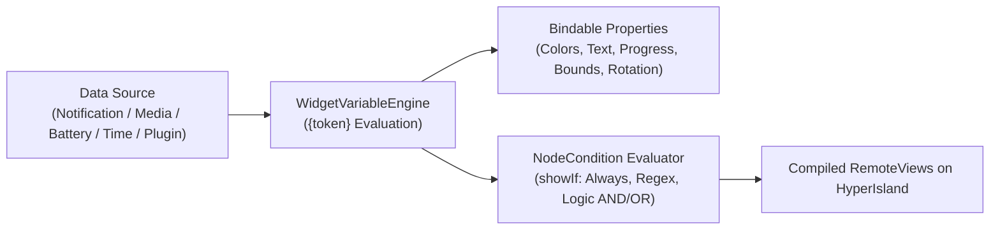

A key strength of the **Micro-Widgets Studio** in Hyper Bridge 0.6.0-beta4 is its dynamic execution engine. Rather than rendering static mockups, every property can be tied to live notification data, media sessions, device telemetry, and conditional rules.



---

## 1. Dynamic Variables & `{token}` Syntax

The `WidgetVariableEngine` automatically evaluates placeholder tokens wrapped in curly brackets `{token}` at render time. If a token is temporarily unavailable (e.g., media is not playing), it safely resolves to an empty string or fallback value without crashing the widget.

### Notification Variables

| Token | Data Type | Description |
|---|---|---|
| `{notif.title}` | String | The main headline or sender name of the notification. |
| `{notif.text}` | String | The body text or message preview. |
| `{notif.progress}` | Integer (0–100) | Current progress percentage reported by the notification. |
| `{notif.package}` | String | Android package name of the issuing application (e.g., `com.spotify.music`). |

### Media Playback Variables
Hyper Bridge connects directly to the Android `MediaSession` manager to pull high-precision playback data:

| Token | Fallback | Description |
|---|---|---|
| `{media.track}` | `{notif.title}` | Title of the active audio/video track. |
| `{media.artist}` | `{notif.text}` | Performing artist or channel name. |
| `{media.progress}` | `{notif.progress}` | Real-time playback position as a percentage (0–100). |
| `{media.duration}` | *None* | Total track length formatted as `MM:SS`. |
| `{media.position}` | *None* | Elapsed playback time formatted as `MM:SS`. |
| `{media.is_playing}` | `"false"` | Boolean string (`"true"` / `"false"`). |
| `{media.state}` | *None* | Raw playback state (e.g., `PLAYING`, `PAUSED`, `BUFFERING`). |

### Device & Telemetry Variables

| Token | Example | Description |
|---|---|---|
| `{device.battery}` | `84` | Current battery level (0–100). |
| `{time.now}` | `14:25` | Current local time formatted according to user preferences. |

### Color & Palette Tokens

| Token | Resolves To | Description |
|---|---|---|
| `{theme.primary}` | `#3DDA82` | Primary accent color from the active theme or color scheme. |
| `{theme.accent}` | `#00E5FF` | Secondary accent color. |
| `{theme.surface}` | `#1E1E1E` | Card surface container color. |
| `{scheme.<role>}` | Hex string | Direct access to any Material 3 color role (e.g., `{scheme.primary}`, `{scheme.surfaceContainer}`). |

### External Content Source Tokens (`{source.<id>.<field>}`)
Hyper Bridge allows third-party apps, plugins, and automation tools (like Tasker) to push custom data to HyperIsland widgets via the `UPDATE_SOURCE` broadcast:

```text
{source.weather.temp}       → Resolves current temperature from a weather plugin
{source.crypto.btc_price}   → Resolves live Bitcoin price from a finance helper
```

---

## 2. The Studio Formula Dialog (`StudioFormulaDialog`)

In addition to static text templates, nearly every visual property can be bound to dynamic formulas using the **Formula Dialog**:

```text
┌────────────────────────────────────────────────────────┐
│ Formula: Text Color Hex                                │
├────────────────────────────────────────────────────────┤
│ Template: {scheme.primary}                             │
│                                                        │
│ Evaluates to: #38BDF8 (in current scenario)           │
├────────────────────────────────────────────────────────┤
│ Quick Tokens:                                          │
│ [ {notif.title} ]  [ {media.track} ]  [ {device.battery} ]│
│ [ {theme.primary} ] [ {scheme.primary} ] [ {time.now} ]  │
└────────────────────────────────────────────────────────┘
```

### Bindable Properties (`BindableProperty`)
Tap the **Formula (Fx)** icon next to any property in the Studio Inspector to bind a dynamic formula:

- **Text**: `template`, `colorHex`, `fontSizeSp`
- **Progress**: `valueTemplate`, `progressColorHex`, `gradientEndColorHex`, `trackColorHex`, `strokeWidthDp`
- **Button**: `label`, `textColorHex`, `backgroundHex`, `icon`, `subIcon`, `strokeColorHex`
- **Image**: `tintHex`
- **Container**: `backgroundHex`
- **Geometry**: `widthDp`, `heightDp`, `opacity`, `rotation`

---

## 3. Visibility Conditions (`NodeCondition`)

You don't always want every element visible. For instance:
- A "Reply" button should only appear if the notification actually supports quick reply.
- A progress bar should stay hidden unless there is an active download or media session.
- A verification code badge should only display if an OTP code is detected.

Switch to the **Visibility** tab on any element to configure its display rule:

### Core Condition Types

| Condition Mode | Parameter | True When |
|---|---|---|
| **Always** | *None* | The element is always displayed. |
| **Has Smart Action** | `type` (`OTP`, `URL`, `PHONE`, `TRACKING`) | Hyper Bridge detects a matching smart action on the notification. |
| **Has Button Action** | `index` (0, 1, 2...) | The notification carries an action button at that slot. |
| **Can Reply** | *None* | The notification includes a direct inline reply input (`RemoteInput`). |
| **Has Progress** | *None* | The notification carries numeric progress data. |
| **Media Playing** | *None* | Active playback is currently playing. |
| **Value Not Blank** | `template` | The resolved token string is not empty or whitespace. |
| **Value Matches (Regex)**| `template`, `regex` | The resolved string matches the regular expression pattern. |

---

## 4. Compound Rules & Quick Presets

### Compound Logic (AND / OR / NOT)
Switch the Condition Mode to **Compound** to combine multiple criteria:
- **Match ALL rules (AND)**: Every sub-rule must pass for the element to display.
- **Match ANY rule (OR)**: If any single sub-rule passes, the element is displayed.
- **Invert Rule (NOT)**: Flips the condition logic (e.g., "Show ONLY when media is NOT playing").

### Quick Presets
Tap **Presets** to apply common smart behaviors in one tap:

- **OTP Code**: Visible only when an SMS or 2FA notification carries a one-time passcode.
- **Active Progress**: Visible only when progress percent is between 1% and 100%.
- **Quick Reply**: Visible only on messaging notifications with inline reply capabilities.
- **Low Battery**: Visible only when `{device.battery}` is less than 20%.

---

## Live Testing with the Scenario Switcher

Whenever you write a formula or condition, use the **Studio Scenario Switcher** (described in [Part 1]()) to test how your element reacts across different notification states:

- Switch to **🎵 Media Playing**: Verify that your track title resolves and playback progress displays.
- Switch to **🔋 Low Battery**: Check that your low-battery warning badge turns visible.
- Switch to **✉️ Standard Notification**: Confirm that media controls hide cleanly and only message text is shown.

---

## What's Next in the Series?

Now that you know how to build dynamic, responsive layouts, proceed to **Part 4** to master Material 3 dynamic color schemes and YAML palette definitions:

👉 **[Part 4: Color Schemes & Material 3 Dynamic Palettes]()**
