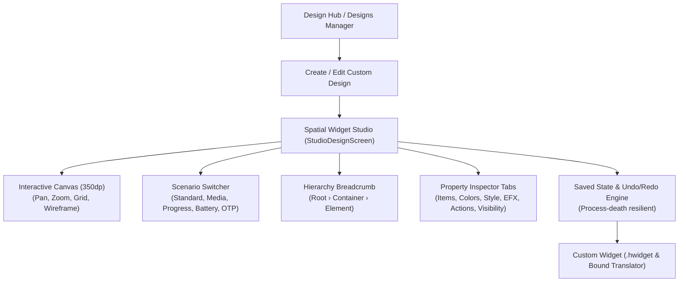

Introduced in **Hyper Bridge 0.6.0-beta4**, the **Micro-Widgets Studio** brings KWGT-style element-by-element design capabilities directly to Xiaomi HyperOS **HyperIsland** (Super Island).

Instead of being restricted to fixed layout templates, you can now construct freeform, layer-based micro-widgets with custom typography, responsive progress bars, interactive buttons, dynamic image masks, and Material 3 expressive color schemes.



---

## 1. Custom Island Widgets vs. System Widgets

Hyper Bridge provides two complementary ways to display widgets on HyperIsland:

| Feature | System Widgets (AppWidget Host) | Custom Island Widgets (Micro-Widgets Studio) |
|---|---|---|
| **Added In** | v0.6.0-beta1 | **v0.6.0-beta4** |
| **Origin** | Standard Android home-screen widgets provided by installed apps (e.g., Spotify 4x1, Google Keep, Weather). | Custom micro-widgets designed element by element or imported from community creators. |
| **Rendering** | Android `AppWidgetHostView` rendered in floating card. | Native RemoteViews compiled from an AST document tree (`CustomWidgetDocument`). |
| **Dynamic Data** | Only what the host app exposes. | Live notification tokens, media playback sessions, device battery, time, and external content sources. |
| **Trigger Mechanism** | Manual tap, persistent pinned island, or notification events. | Notification interceptor rules via the **Custom Translators Engine**. |
| **Package Format** | N/A (system-bound). | Standalone `.hwidget` archives containing `widget.json`, `translator.json`, and local `assets/`. |

---

## 2. Accessing the Studio in Hyper Bridge

You can enter the Studio through either of the following paths:

### Method A: From the Designs Manager (Recommended)
1. Open the **Design** tab from the main bottom navigation bar.
2. Tap the **Designs** Bento card to open the **Designs Manager**.
3. Tap **Add Design** (or the floating `+` button).
4. In the creation sheet, select **Custom design (Studio)** to open a clean canvas.

### Method B: Editing or Duplicating an Existing Design
1. In the **Designs Manager**, locate any active custom design card.
2. Tap the **Edit (Pencil)** icon to open it directly inside the Studio.
3. Or tap **Duplicate** to clone the design with decoupled widget IDs and unique assets, allowing you to create variations safely without modifying your original design.

---

## 3. The Studio Interface Walkthrough

When you enter the Studio (`StudioDesignScreen`), you will see the interactive studio environment:

```text
┌────────────────────────────────────────────────────────┐
│ [←]  Design Name                          [↩] [↪]  [💾] │
├────────────────────────────────────────────────────────┤
│ Root › Header Row › Song Title                         │
├────────────────────────────────────────────────────────┤
│                                                        │
│   ┌──────────────────────────────────────────────┐     │
│   │ [Zoom]    LIVE ISLAND CANVAS (350dp)         │     │
│   │ [Grid]    (Drag & drop, resize, select)      │     │
│   │ [Wire]                                       │     │
│   │ [Center]                                     │     │
│   └──────────────────────────────────────────────┘     │
│                                                        │
│ [Scenario Switcher: 🎵 Media Playing ▼]               │
├────────────────────────────────────────────────────────┤
│ [ Items ] [ Position ] [ Colors ] [ Style ] [ Action ] │
├────────────────────────────────────────────────────────┤
│ Inspector Properties & Sliders                         │
└────────────────────────────────────────────────────────┘
```

### Top Navigation Bar
- **Back Button (`←`)**: Prompts to save or discard if you have unsaved changes.
- **Title**: Displays the current widget document name.
- **Undo / Redo (`↩` / `↪`)**: Instantly step backward or forward through your canvas edits.
- **Export (`Share`)**: Generates and shares a standalone `.hwidget` package via Android's share sheet.
- **Save (`💾`)**: Commits the current document tree and registers the bound translator.

### Breadcrumb Navigation Bar
The breadcrumb bar allows you to navigate nested layouts effortlessly. Tapping any ancestor segment (e.g., `Root` or `Group 1`) jumps selection up the hierarchy without losing context.

---

## 4. Canvas Controls & Floating Action Toolbar

On the side of the preview canvas sits the **Floating Action Toolbar**:

| Tool Icon | Function | Description |
|---|---|---|
| **Zoom (`+` / `-`)** | Canvas Magnification | Zoom between 50% and 200% to inspect small typography, sub-icons, and pixel alignments. Tap 100% to reset zoom. |
| **Pan / Recenter** | Viewport Alignment | Resets pan offsets and centers the island card on your display. |
| **Grid Toggle** | Spatial Alignment Grid | Toggles a subtle 8dp dot grid across the canvas to guide spacing and element alignment. |
| **Wireframe Mode** | Boundary Outlines | Replaces filled graphics with structural boundary boxes, helping you diagnose invisible containers, nested paddings, and overlapping bounds. |

### Canvas Sizing Presets
The canvas width is standardized to **350dp** to match Xiaomi HyperOS Super Island constraints. You can configure the canvas height in the **Global / Design** tab:

- **Small (`100dp`)**: Compact single-line cards, playback pill expanders, and minimal status pills.
- **Medium (`180dp`)**: Standard notification card height with title, body, artwork, and action buttons.
- **Large (`280dp`)**: Multi-row dashboards, ticket previews, and detailed tracking cards.
- **X-Large (`380dp`)**: Full-height spatial islands featuring rich data feeds, system controls, and detailed media covers.

---

## 5. Live Scenario Switcher

Testing notification widgets usually requires sending dummy notifications from another device. Hyper Bridge solves this with the built-in **Studio Scenario Switcher**:

Tap the scenario selector pill below the canvas to instantly simulate realistic notification and hardware states:

1. **Standard Notification**: Title, message body, app icon, sender avatar, and basic notification actions.
2. **Active Media Playback**: Simulates a live `MediaSession` with track title, artist name, playing/paused playback states, elapsed/total duration, and live progress bars.
3. **Active Progress / Download**: Simulates file transfers, ride-sharing ETAs, or delivery checkpoints with 0–100% progress metrics.
4. **Low Battery / Device State**: Simulates device hardware variables such as `{device.battery}` at 15% and formatted timestamps.
5. **OTP / Smart Action**: Simulates incoming verification codes with smart action chips (`OTP`, `URL`, `PHONE`, `TRACKING`).
6. **Custom Scenario**: Configure mock text strings and variables to test your exact edge cases.

---

## 6. Draft Persistence & Safety Workflow

Designing complex widgets requires peace of mind:

- **Process-Death Resilient Drafts**: Edits are stored in `SavedStateHandle`. If Android terminates the process in the background or you rotate your screen, your in-progress layout is restored.
- **Undo / Redo Stack**: All node insertions, moves, property edits, and deletions maintain an undo history.
- **Restore Last Saved**: Reverts all uncommitted canvas changes back to the state stored on disk.
- **Discard Confirmation Dialog**: If you press back while having uncommitted modifications, Hyper Bridge warns you before losing work.

---

## What's Next in the Series?

Now that you understand the studio layout and navigation, proceed to **Part 2** to learn how to add, style, and layer all 6 fundamental element types:

👉 **[Part 2: Custom Widget Elements & Visual Properties]()**
