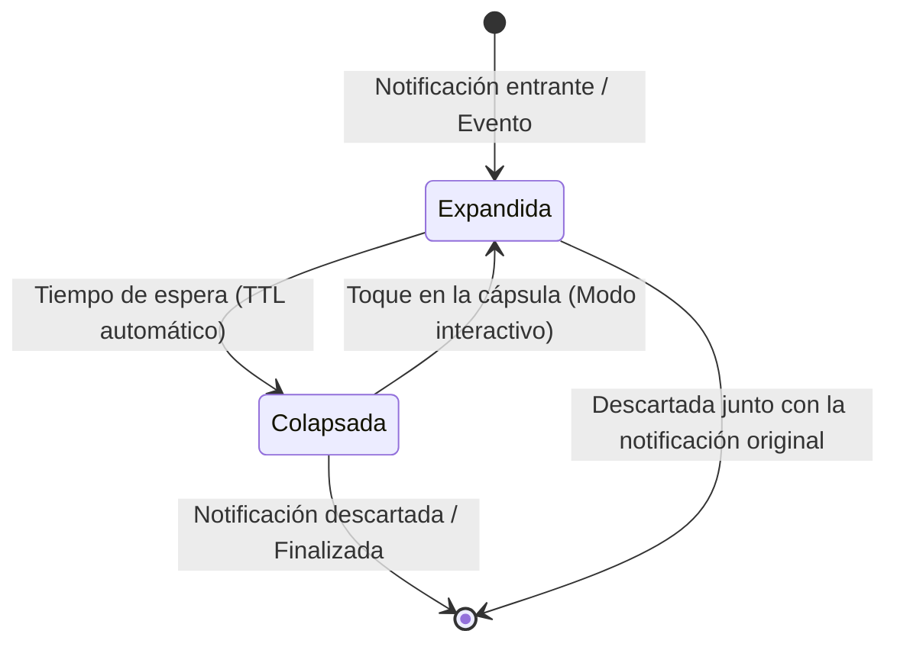
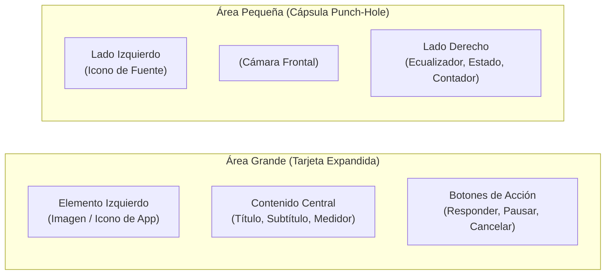

El **Motor de Islas Dinámicas** es el núcleo de renderizado de HyperBridge. Intercepta las notificaciones estándar de Android y las transforma en presentaciones nativas de **Xiaomi HyperOS HyperIsland / Super Island** (Notificaciones destacadas / de enfoque) alrededor del recorte de la cámara frontal.

En lugar de dibujar una capa flotante simulada que consume procesador e interfiere con los gestos táctiles, HyperBridge emite contratos nativos que procesa directamente el `SystemUI` oficial de Xiaomi.

---

## 🎭 Los Dos Estados de Visualización de la Isla

Cada isla dinámica realiza transiciones fluidas entre dos estados visuales fundamentales:

### 1. Estado Expandido (Tarjeta Flotante / Heads-Up)
* **Cuándo aparece:** Inmediatamente al llegar un nuevo evento (mensaje de chat, nuevo tema musical, alerta de navegación o temporizador).
* **Presentación:** Muestra la tarjeta completa con avatares de remitente, botones de acción interactivos, barras de progreso o portadas de álbum.
* **Comportamiento:** Permanece visible durante el tiempo de espera configurado (por ejemplo, 5 a 10 segundos) antes de colapsar suavemente a la cápsula compacta.

### 2. Estado Colapsado (Cápsula Compacta / Punch-Hole)
* **Cuándo aparece:** Tras expirar el tiempo de la tarjeta expandida mientras el evento continúe activo en segundo plano (reproducción musical, ruta GPS o llamada en curso).
* **Presentación:** Una cápsula mínima y elegante que rodea la cámara. Muestra un icono de estado en el lado izquierdo y un medidor o indicador secundario en el derecho.
* **Interactividad:** Al tocar la cápsula, esta vuelve a expandirse instantáneamente para ofrecer controles completos.

---

## 📐 Estructura de Diseño: Áreas Pequeña y Grande

Bajo el protocolo nativo de Xiaomi HyperOS, cada plantilla se divide en dos áreas principales:

* **`smallIslandArea`**: Controla los elementos visibles en los extremos izquierdo y derecho del recorte de la cámara cuando la cápsula está minimizada.
* **`bigIslandArea`**: Controla la disposición completa de la tarjeta cuando la isla se expande.

---

## 🎨 Las 10 Plantillas Oficiales de Xiaomi HyperOS

HyperBridge incluye compatibilidad nativa con las 10 plantillas del sistema HyperOS:

1. **Multimedia / Reproductor de Audio**: Cubierta de álbum, barra de progreso y botones multimedia adaptados dinámicamente al color de la portada.
2. **Llamadas Entrantes y Activas**: Foto del contacto, duración de llamada y botones de descolgar / colgar con formas personalizadas.
3. **Navegación Paso a Paso**: Flecha de dirección, distancia al siguiente giro y hora estimada de llegada.
4. **Temporizador y Cronómetro**: Cuenta atrás en vivo con botón rápido de pausa o cancelación.
5. **Progreso de Descargas**: Porcentaje numérico, velocidad de transferencia y barra de progreso animada.
6. **Seguimiento de Envíos y Delivery**: Estado del pedido, icono de repartidor y mapa simplificado.
7. **Grabación de Pantalla y Audio**: Tiempo transcurrido con accesos directos para pausar o detener.
8. **Pagos y Autenticación OTP**: Resumen de transacción con botón de 1 toque para copiar código de verificación.
9. **Tarjeta de Embarque / Vuelos**: Código de puerta de embarque, asiento y hora de salida.
10. **Avisos Informativos Generales**: Notificaciones estándar con icono destacado y botones de acción rápida.
