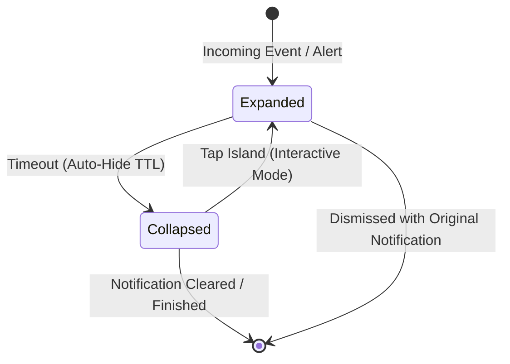
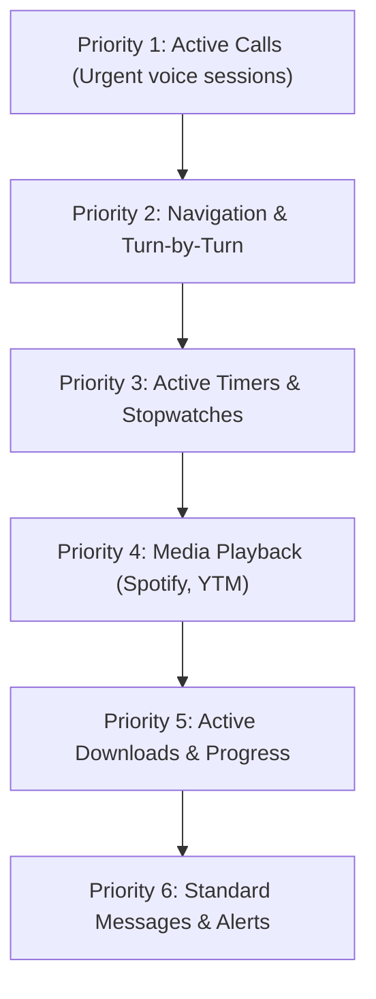

The **Dynamic Island Engine** is the core rendering pipeline of HyperBridge. It intercepts standard Android status bar notifications and translates them into native **Xiaomi HyperOS HyperIsland / Super Island** (Focus/Featured Notification) presentations wrapped around your camera punch hole.

Rather than drawing a simulated overlay that consumes CPU and interrupts touchscreen gestures, HyperBridge outputs native system contracts directly processed by Xiaomi's `SystemUI`.

---

## 🎭 The Two Island Display States

Every dynamic island transitions smoothly between two primary visual states:



### 1. Expanded Heads-Up Popup
When an active event first occurs (such as an incoming call, a new chat message, or a track change):
* The island immediately blooms into a **rich expanded card** displaying full artwork, contact avatars, secondary subtitles, live progress bars, and interactive buttons.
* **Auto-Hide TTL**: The card remains expanded for a user-configured duration (e.g. `5s` to `60s`, configurable in **Global Settings** &rarr; **Island Behavior** &rarr; **Auto-hide Island**) before automatically collapsing.
* **Float Only on First Alert**: For rapidly updating notifications (like download progress or file transfers), HyperBridge includes a "Float only on first alert" option to prevent annoying repeated popups every time the progress increments.

### 2. Collapsed Island Capsule (Pill)
Once the expanded card times out:
* The island collapses smoothly into an ultra-compact **pill capsule** hugging your camera hole.
* **Persistent Awareness**: You can glance at active media, ongoing timer countdowns, or call statuses without losing valuable screen real estate.
* **Direct Interaction**: Tapping the collapsed capsule can either reopen the expanded card or jump directly into the source app via activity intents.

---

## 📐 Anatomy: `smallIslandArea` vs. `bigIslandArea`

Every native Xiaomi island specification defines two distinct presentation layouts:

```
┌─────────────────────────────────────────────────────────────┐
│  bigIslandArea (Expanded State)                             │
│  ┌──────────────┐  Title & Content Text     ┌────────────┐  │
│  │ Left Icon    │  Subtitle / Variable      │ Right Slot │  │
│  └──────────────┘                           └────────────┘  │
│  [================ Progress Bar ================]           │
│  [ Action 1 ]         [ Action 2 ]         [ Action 3 ]     │
└─────────────────────────────────────────────────────────────┘

┌──────────────────────────────────────┐
│ smallIslandArea (Collapsed Capsule)  │
│ (Icon) [Camera Cutout] (Timer/Status)│
└──────────────────────────────────────┘
```

1. **`smallIslandArea` (The Collapsed Pill)**:
   - **`imageTextInfoLeft`**: Displays the application icon, sender avatar, or media album art on the left side of the camera cutout.
   - **`imageTextInfoRight`**: Displays concise dynamic telemetry on the right side of the cutout, such as live stopwatch timers (`MM:SS`), download percentages (`42%`), or animated audio waveforms.

2. **`bigIslandArea` (The Expanded Card)**:
   - **`imageTextInfoLeft` & `imageTextInfoRight`**: Primary headers, sub-labels, and badges.
   - **`progressInfo`**: Configurable linear track or circular progress ring with custom threshold color gradients.
   - **`actionArea`**: Up to three interactive button slots mapped directly to Android notification actions, smart actions, or inline reply inputs.
   - **`bgInfo`**: Background styling, supporting solid colors, Material 3 dynamic color schemes, or rich picture backgrounds (e.g. blurred album art).

---

## 🏛️ The 10 Official Xiaomi HyperOS Template Archetypes

HyperBridge natively supports and generates all 10 official Xiaomi HyperOS Super Island layout archetypes:

| # | Template Archetype | Typical Use Cases | Collapsed Pill | Expanded Controls |
|---|---|---|---|---|
| **1** | **Media Playback** | Spotify, YouTube Music, Apple Music, Podcasts | Album art + Audio wave | Track title, artist, live audio waveforms, play/pause, skip track buttons |
| **2** | **Active Calls** | Phone, WhatsApp Calls, Telegram Calls, Google Meet | Contact avatar + Duration | Contact name, call status (Incoming, Ongoing, Held), live timer, mute & hangup buttons |
| **3** | **Downloads & Progress** | Web browsers, app stores, file transfers | Download glyph + Percentage | File name, download speed, animated progress bar, completion checkmark |
| **4** | **Navigation & Transit** | Google Maps, Waze, Citymapper | Turn arrow + Distance | Maneuver direction, street name, distance to next turn, arrival ETA |
| **5** | **Timers & Countdowns** | Clock app, kitchen timers, pomodoro | Timer icon + Countdown | Remaining time, progress ring, pause, add minute, and cancel buttons |
| **6** | **Ride & Delivery Tracking** | Uber, Bolt, DoorDash, Deliveroo | Vehicle/food icon + ETA | Driver name, vehicle license plate, delivery status, 1-tap call driver action |
| **7** | **Boarding Pass & Travel** | Airlines, Train operators | Flight code + Departure | Flight/train number, origin/destination gates, boarding status, barcode shortcut |
| **8** | **Payment & Wallet** | Banking, Google Wallet | Merchant logo + Status | Transaction summary, payment amount, success animation |
| **9** | **Weather & Environment** | Weather apps, severe alerts | Weather glyph + Temp | Current temperature, rain probability, severe weather alert banner |
| **10** | **Standard & Messages** | SMS, WhatsApp, Telegram, Signal | Sender avatar + Message snippet | Full message text, 1-tap OTP copy button, or [Inline Reply]() box |

---

## ⚡ Multi-Island Prioritization Rules

When multiple applications post active notifications simultaneously, the HyperBridge **Island Update Resolver** strictly prioritizes which event occupies the Super Island:



* **Urgent Preemption**: If you are playing music and an incoming phone call or navigation cue arrives, the call immediately takes precedence over the media player.
* **Graceful Restoration**: Once the call ends or navigation maneuver completes, the island seamlessly restores your media player or active timer.
* **Permanent Island Yielding**: If you have [Permanent Island]() enabled, the idle pill yields momentarily to active alerts and returns automatically once all notifications are dismissed.

---

## 🚀 Customizing Island Layouts

Want to build your own layouts beyond the standard templates?
* **[Design Hub & Custom Designs]()**: Compose layouts using official templates or browse community designs.
* **[Custom Widget Studio]()**: Visually construct your own element-by-element micro-widgets with custom formulas and tokens.
* **[Custom Translators (`.htrans`)]()**: Map any specific app notification using regex extractions and `RAW_PARAM_V2` contracts.
