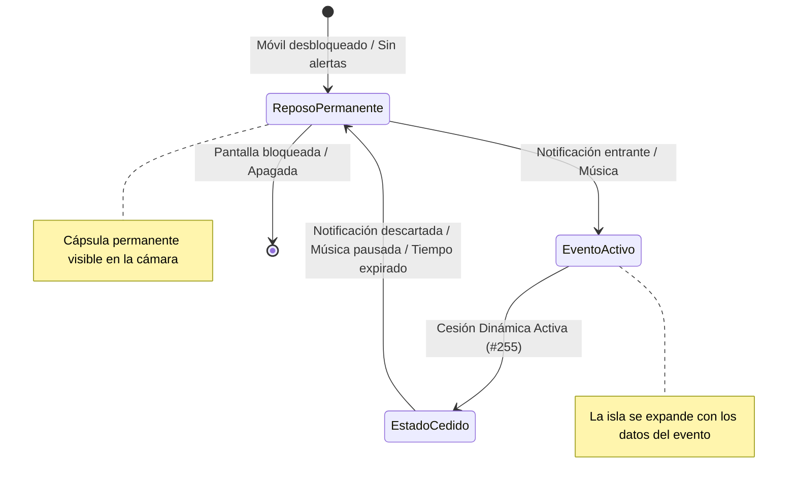
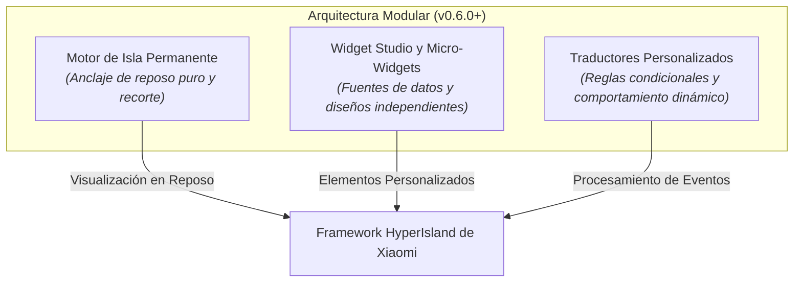

La **Isla Permanente** (*Permanent Island*) permite que el orificio de la cámara de tu dispositivo se integre continuamente en una cápsula dinámica estética, incluso cuando no haya música en reproducción ni notificaciones activas.

---

## 🧭 Cómo Funciona la Isla Permanente

En el comportamiento estándar de HyperOS, la isla solo aparece cuando ocurre un evento activo y desaparece por completo al terminar.

Al activar la **Isla Permanente**:
- **Cápsula en Reposo**: Se muestra de forma continua una cápsula compacta y elegante alrededor de la cámara mientras el móvil está desbloqueado.
- **Transición Fluida ante Notificaciones**: Al llegar una notificación o evento en tiempo real, la isla permanente cede suavemente el espacio y se transforma en la tarjeta del evento entrante.
- **Reaparición Automática**: Una vez descartadas o finalizadas las notificaciones activas, la cápsula regresa de forma inmediata a su estado de reposo mínimo.
- **Sin Molestias en la Cortina de Notificaciones**: La isla permanente funciona como un elemento puramente visual en pantalla y **no satura tu barra ni panel de notificaciones**.

---

## ⚡ Motor de Cesión Inteligente (Novedad en v0.6.0)

En versiones anteriores de HyperBridge, en ciertas ocasiones la Isla Permanente podía permanecer oculta de forma indefinida tras reproducir música o recibir notificaciones de enfoque prolongadas ([#255](https://github.com/D4vidDf/HyperBridge/issues/255)).

HyperBridge v0.6.0 introduce una **Revisión Completa del Motor de Cesión** ([#304](https://github.com/D4vidDf/HyperBridge/pull/304)):

### 1. Cesión Momentánea
La isla permanente gestiona las prioridades de forma contextual:
- Cuando llega un evento de mayor prioridad (como una llamada entrante, indicación GPS o mensaje importante), la isla permanente cede el anclaje de pantalla inmediatamente a la tarjeta entrante.
- Durante la reproducción de música activa (Spotify, YouTube Music), la isla cede su lugar a la cápsula musical.

### 2. Restauración Consciente del Estado
El motor supervisa activamente las sesiones del sistema en vivo:
- En cuanto la música se pausa o finaliza, el bloqueo de cesión se libera al instante.
- Si una notificación temporal expira, la isla no queda en blanco; restaura automáticamente la cápsula de reposo sin necesidad de reiniciar la app ni bloquear la pantalla.

---

## 🧩 Arquitectura Desacoplada de Micro-Widgets (v0.6.0)

A partir de **v0.6.0-beta5**, HyperBridge desacopló por completo la gestión de fuentes y micro-widgets de la Isla Permanente ([#432](https://github.com/D4vidDf/HyperBridge/pull/432)):

### Ventajas de la Arquitectura Desacoplada:
- **Anclaje de Reposo Exclusivo**: La Isla Permanente se concentra exclusivamente en mantener la cápsula estética alrededor de la cámara, garantizando un consumo mínimo de recursos en reposo.
- **Ciclo de Vida Independiente para Micro-Widgets**: Los widgets personalizados (relojes, anillos de batería, tiempo) se administran de forma independiente mediante **Widget Studio**.
- **Mayor Estabilidad**: Editar, cambiar o eliminar diseños en el Design Hub no interrumpe el servicio en segundo plano de la isla permanente.

---

## ⚙️ Configuración y Opciones

Configura la Isla Permanente en HyperBridge en **Ajustes Globales** &rarr; **Isla Permanente**:

### Ajustes Principales

- **Interruptor de Isla Permanente**: Activa o desactiva la cápsula continua de reposo.
- **Lienzo de Vista Previa**: Muestra en tiempo real cómo se alinea la cápsula con la cámara frontal y los iconos de la barra de estado (reloj y batería).
- **Alineación con la Cámara**: Respeta la posición del recorte configurada en el asistente de inicio.
- **Integración con Pantalla de Bloqueo**: Combinada con traductores configurados con `Mostrar en pantalla de bloqueo` ([Soporte de Pantalla de Bloqueo v0.6.0]()), la cápsula hace una transición suave entre el modo bloqueo (`islandProperty: 0`) y el modo reposo desbloqueado (`islandProperty: 1`).
