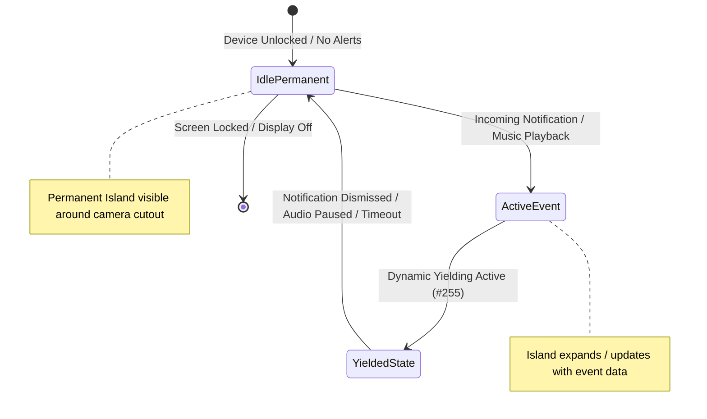
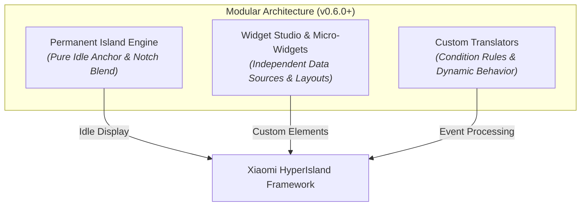

**Permanent Island** allows your device's camera punch hole to always blend seamlessly into a continuous, interactive dynamic island—even when no music is playing and no active notifications are present.

---

## 🧭 How Permanent Island Works

In default HyperOS behavior, the **HyperIsland** (Super Island) only renders when an active event occurs (such as incoming notifications, music playback, or navigation cues) and collapses completely once dismissed or timed out.

When **Permanent Island** is enabled:
- **Idle Camera Pill**: An elegant, compact pill is persistently displayed over your camera cutout while the device is in an idle state.
- **Smart Notification Transition**: The moment an incoming notification or Live Update arrives, the permanent island smoothly yields and morphs into the active event island.
- **Auto Reappearance**: Once all active notifications are cleared or timed out, the island effortlessly returns to its minimal camera pill shape.
- **Zero Notification Shade Clutter**: The idle permanent island runs purely as an on-screen visual element and **will not clutter your notification shade**.

---

## ⚡ Smart Yielding Engine (v0.6.0 Overhaul)

In earlier versions of HyperBridge, users could encounter edge cases where the Permanent Island remained hidden indefinitely behind long-lived native focus or media notifications ([#255](https://github.com/D4vidDf/HyperBridge/issues/255)). If a media session or background task lingered without posting new updates, the idle island could get stuck in a suppressed state.

HyperBridge v0.6.0 introduces a complete **Yielding Engine Overhaul** ([#304](https://github.com/D4vidDf/HyperBridge/pull/304)):

### 1. Momentary Yielding
The permanent island treats incoming alerts with contextual priority:
- When a higher-priority event arrives (such as an incoming call, turn-by-turn navigation prompt, or messaging heads-up), the permanent island immediately yields the screen anchor to the incoming card.
- During active media playback (Spotify, YouTube Music), the permanent island yields to the media capsule or player.

### 2. State-Aware Restoration
Instead of relying on rigid, one-off dismissal callbacks, the engine now actively monitors SystemUI Live Update sessions:
- The moment active media pauses, finishes, or is dismissed, the yielding lock is released.
- If a temporary focus notification times out, the island does not stay blank; it automatically restores the permanent idle pill without requiring manual screen locks or app restarts.

---

## 🧩 Decoupled Micro-Widget Architecture (v0.6.0)

In versions prior to 0.6.0, custom micro-widget bindings and source management were tightly coupled directly to the permanent island service lifecycle. This introduced unnecessary complexity and could cause state synchronization conflicts when switching themes or editing translators.

In **v0.6.0-beta5**, HyperBridge completely decoupled micro-widget source bindings from the Permanent Island ([#432](https://github.com/D4vidDf/HyperBridge/pull/432)):

### Benefits of the Decoupled Architecture:
- **Dedicated Idle Anchor**: The Permanent Island is now dedicated strictly to maintaining the clean camera pill and idle anchor, ensuring zero unnecessary CPU overhead during idle display.
- **Independent Micro-Widget Lifecycles**: Custom micro-widgets (clocks, battery rings, weather icons, network meters) are independently managed through **Widget Studio**.
- **Resilient Binding**: Modifying, deleting, or switching widget designs in the Design Hub no longer interrupts the permanent island background service.

---

## ⚙️ Configuration & Setup

Configure Permanent Island in HyperBridge under **Global Settings** &rarr; **Permanent Island**:



### Settings & Controls

- **Permanent Island Toggle**: Master switch to enable or disable the persistent idle island pill.
- **Preview Canvas**: Real-time interactive preview demonstrating how the pill aligns with your device's camera cutout and status bar elements (clock and battery icons).
- **Cutout Alignment**: Respects the camera cutout position configured during the initial [Onboarding Wizard]().
- **Lock Screen Synergy**: When paired with custom translators configured with `Show on lock screen` ([v0.6.0 Lock Screen Support]()), the island transitions cleanly between lock screen keyguard display (`islandProperty: 0`) and unlocked idle mode (`islandProperty: 1`).

---

## 🎯 Why Use Permanent Island?

1. **Aesthetic Continuity**: Eliminates the abrupt transition where the camera hole stands out against light backgrounds.
2. **Instant Visual Touchpoint**: Gives your HyperOS device a signature look similar to dedicated hardware island notches.
3. **Ultra-Low Battery Overhead**: Runs with near-zero CPU and GPU overhead by leveraging Xiaomi's native hardware-accelerated SystemUI layer.

---

## 🔗 Related Features

- **[Dynamic Island Engine]()**: Learn how notifications morph between collapsed pills and expanded cards.
- **[Widget Studio]()**: Create custom micro-widgets and layouts.
- **[Design Hub & Custom Themes]()**: Download and apply custom color palettes and `.hscheme` themes.
- **[Lock Screen Behavior]()**: Understand dynamic `islandProperty` keyguard handling.
