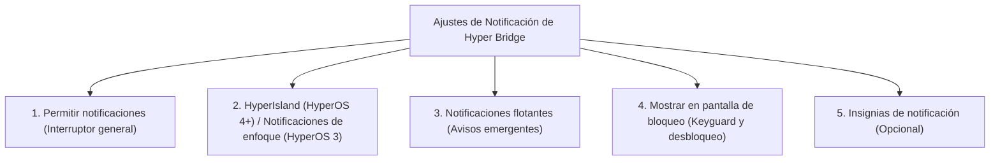

En Xiaomi HyperOS, las cápsulas y tarjetas dinámicas alrededor del orificio de la cámara funcionan mediante un framework del sistema específico.

> [!NOTE]
> ### 🏷️ Nomenclatura en HyperOS 4 vs. HyperOS 3
> * **HyperOS 4+:** Xiaomi renombró oficialmente esta función como **HyperIsland** (o *Super Island* / *超级岛*). En los ajustes del sistema, el interruptor aparece directamente como **HyperIsland**.
> * **HyperOS 3:** Esta función se denomina **Notificaciones de enfoque** (o *Notificaciones destacadas* / *焦点通知*).
>
> Dependiendo de la versión de HyperOS instalada y del idioma de tu dispositivo, busca **HyperIsland** o **Notificaciones de enfoque**.

A diferencia de las notificaciones estándar de Android que solo aparecen en la barra superior o cortina desplegable, **HyperIsland / Notificaciones de enfoque** cuentan con autorización especial para mostrarse directamente como cápsulas interactivas alrededor del recorte de la cámara.


**Consejo clave de diagnóstico:** Si HyperBridge está en ejecución y el acceso a notificaciones está concedido, pero las islas nunca se muestran alrededor de la cámara, ¡la causa suele ser la falta del permiso de **HyperIsland / Notificaciones de enfoque** o de **Notificaciones flotantes**!


---

## 📋 Matriz de Permisos Requeridos

Para que HyperBridge dibuje tanto la cápsula compacta como las tarjetas expandidas, asegúrate de habilitar estos interruptores en HyperOS:

1. **Permitir notificaciones**: Interruptor principal que permite a HyperBridge emitir alertas de estado.
2. **HyperIsland (HyperOS 4+) / Notificaciones de enfoque (HyperOS 3)**: El permiso especializado de Xiaomi que habilita la cápsula punch-hole alrededor de la cámara.
3. **Permitir notificaciones flotantes**: Permite que la isla aparezca en formato flotante sobre aplicaciones a pantalla completa y juegos.
4. **Mostrar en pantalla de bloqueo**: Permite que las actualizaciones en tiempo real y los traductores configurados con `islandProperty` se muestren mientras el móvil está bloqueado y hagan la transición fluida al desbloquear.

---

## 🛠️ Paso a Paso: Cómo Habilitar HyperIsland / Notificaciones de Enfoque

### Método 1: Desde la Pantalla de Estado del Sistema en HyperBridge (Recomendado)

1. Abre **HyperBridge** y ve a **Ajustes** &rarr; **Estado del Sistema** (*System Health*).
2. Localiza la tarjeta de **HyperIsland / Notificaciones de Enfoque**.
3. Pulsa **Abrir Ajustes**. HyperBridge abrirá directamente la pantalla de configuración de notificaciones de la app.
4. Activa **HyperIsland** (o **Notificaciones de enfoque**) y **Permitir notificaciones flotantes**.

---

### Método 2: Manualmente desde los Ajustes de HyperOS

Si prefieres configurarlo manualmente desde los ajustes de tu Xiaomi:

1. Abre los **Ajustes** del teléfono.
2. Ve a **Notificaciones y barra de estado**.
3. Pulsa en **Notificaciones de aplicaciones**.
4. Busca y selecciona **Hyper Bridge**.
5. Verifica y activa los siguientes interruptores:
   - **Permitir notificaciones** &rarr; **ACTIVADO**.
   - **HyperIsland** (en HyperOS 4+) o **Notificaciones de enfoque** / **destacadas** (en HyperOS 3) &rarr; **ACTIVADO**.
   - **Permitir notificaciones flotantes** &rarr; **ACTIVADO**.
   - **Mostrar en pantalla de bloqueo** &rarr; **ACTIVADO**.

---

## 💡 Evitar Doble Notificación Emergente (Configuración Flotante)

Cuando una app como Telegram, WhatsApp o Spotify envía un mensaje, Xiaomi HyperOS puede intentar mostrar su **aviso emergente nativo de Android** al mismo tiempo que HyperBridge dibuja la **HyperIsland** en la cámara.

Para evitar avisos duplicados:

1. Abre **HyperBridge** &rarr; **Ajustes** &rarr; **Configuración de Notificaciones Flotantes**.
2. La app te mostrará una lista de tus aplicaciones activas.
3. Puedes abrir los ajustes del sistema de cada app de mensajería y desactivar sus *notificaciones flotantes*, manteniendo únicamente las de **HyperBridge**. De este modo, solo la isla dinámica aparecerá en la pantalla.
