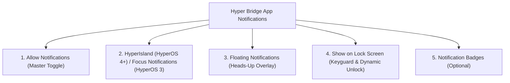

On Xiaomi HyperOS, dynamic status cards and capsules around the camera cutout are powered by a dedicated system framework. 

> [!NOTE]
> ### 🏷️ Naming on HyperOS 4 vs. HyperOS 3
> * **HyperOS 4+:** Xiaomi officially renamed this capability to **HyperIsland** (or *Super Island* / *超级岛*). In system settings, the permission toggle appears directly as **HyperIsland**.
> * **HyperOS 3:** This capability is labeled as **Focus Notifications** (also referred to as *Featured Notifications* or *焦点通知*).
>
> Depending on your device's installed HyperOS version and system language, look for either **HyperIsland** or **Focus notifications**.

Unlike standard Android notifications that only sit in your pull-down shade, **HyperIsland / Focus Notifications** are granted special system clearance to render as interactive status capsules and expanded cards directly around your camera punch hole.


**Top Troubleshooting Tip:** If HyperBridge is running and the Notification Listener is connected, but dynamic islands never appear around your camera hole, a missing **HyperIsland / Focus Notification** or **Floating Notification** permission is almost always the cause!


---

## 🔑 Required HyperOS Notification Permissions

For HyperBridge to render both the collapsed pill and the expanded island cards, **Hyper Bridge itself** must have the following notification capabilities enabled in HyperOS:

1. **Allow notifications**: Master switch enabling HyperBridge to post status alerts.
2. **HyperIsland (HyperOS 4+) / Focus notifications (HyperOS 3)**: The specialized Xiaomi permission enabling the Super Island punch-hole capsule.
3. **Allow floating notifications**: Allows the island to pop up as a floating heads-up banner over fullscreen apps and games.
4. **Show on lock screen**: Allows Live Updates and custom translators configured with `islandProperty` to display while locked and transition cleanly upon unlocking.

---

## 🛠️ Step-by-Step: Enabling HyperIsland / Focus Notifications

### Method 1: Via HyperBridge System Health (Recommended)

1. Open **HyperBridge** and navigate to **Settings** &rarr; **System Health**.
2. Locate the **HyperIsland / Focus Notifications** card.
3. Tap **Open Settings**. HyperBridge will launch your device's notification management page directly for HyperBridge.
4. Enable **HyperIsland** (or **Focus notifications**) and **Allow floating notifications**.

---

### Method 2: Manual System Settings Path

If you prefer to configure it directly from HyperOS settings:

1. Open your device's **Settings** app.
2. Scroll down and tap **Notifications & status bar** (or **Notifications & Control center**).
3. Tap **App notifications**.
4. Scroll or search for **Hyper Bridge** and tap it to open its notification channel settings.
5. Verify and enable the following settings:
   - Toggle **Allow notifications** &rarr; **ON**.
   - Toggle **HyperIsland** (on HyperOS 4+) or **Focus notifications** / **Featured notifications** (on HyperOS 3) &rarr; **ON**.
   - Toggle **Allow floating notifications** &rarr; **ON**.
   - Toggle **Show on lock screen** &rarr; **ON**.

---

## 💡 Avoiding Double Popups: Floating Notification Setup

When an app like Telegram, WhatsApp, or Spotify posts an alert, Xiaomi HyperOS may attempt to display its **native Android floating heads-up banner** at the exact same moment HyperBridge renders its **HyperIsland** around the camera hole.

To prevent awkward visual duplication:

1. Open **HyperBridge** &rarr; **Settings** &rarr; **System Health**.
2. Tap **Floating Notification Setup** (or open it from **Global Settings**).
3. The setup screen lists all enabled third-party apps with a direct shortcut to their system notification pages.
4. For each bridged app, open its system notification settings and turn **Allow floating notifications** **OFF**.
5. **Keep Hyper Bridge's floating notification permission enabled.** 

HyperBridge will now receive the alert silently via the Notification Listener and present the sleek Dynamic Island without any clutter from native floating banners!

---

## 🔍 Verification & Next Steps

Once configured, verify your setup:
1. Play a song in your music player (Spotify, YouTube Music) or start a timer in the Clock app.
2. The dynamic island capsule should immediately morph around the camera punch hole.
3. If islands still do not appear, ensure that you have also granted [Notification Listener Access]() and set [Battery Saver & Autostart Whitelist]().
