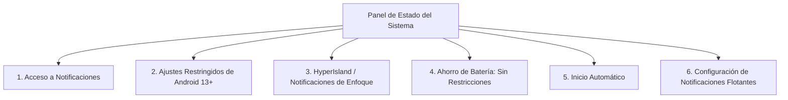
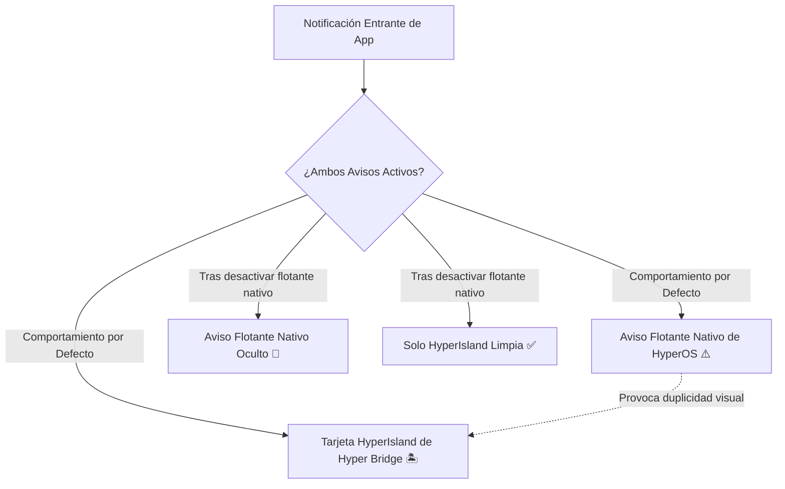

Xiaomi HyperOS es conocido por su estricta gestión de memoria en segundo plano y su sistema de permisos multinivel. Para asegurar que Hyper Bridge intercepte notificaciones de forma fiable, dibuje las islas fluidamente y permanezca activo en segundo plano, la aplicación incluye un panel central de **Estado del Sistema** (`SetupHealthScreen`) y un gestor específico para **Configuración de Notificaciones Flotantes**.

Esta guía te acompaña en cada paso necesario para conseguir un estado **100% Correcto**.

---

## 1. El Panel de Estado del Sistema

En Hyper Bridge, ve a **Ajustes** &rarr; **Estado del Sistema** (o toca la tarjeta de Estado en [Diagnóstico]()):

En la parte superior, un **Banner Principal** refleja el estado global de tu configuración:
- **Verde ("Estado del Sistema: Correcto"):** Todos los permisos esenciales están concedidos y el servicio de escucha está activo.
- **Ámbar / Naranja ("Requiere Atención"):** Faltan uno o más permisos requeridos, lo que impide que las islas se muestren correctamente.



---

## 2. Lista de Permisos Esenciales

Cada tarjeta en la pantalla de Estado del Sistema proporciona un acceso directo en 1 toque a los ajustes correspondientes de Xiaomi:



### Paso 1: Acceso a Notificaciones (Listener)
- **Por qué es necesario:** Android impide que aplicaciones estándar lean las alertas de otras apps. El acceso a notificaciones permite a Hyper Bridge interceptar avisos entrantes y enviarlos al motor de la isla.
- **Cómo otorgarlo:** Pulsa **Conceder Permiso** &rarr; Localiza **Hyper Bridge** en la lista &rarr; Activa el interruptor &rarr; Acepta la confirmación de seguridad de 10 segundos de Xiaomi.
- *Guía detallada:* [Guía de Acceso a Notificaciones]().

---

### Paso 2: Ajustes Restringidos en Android 13+
- **El problema:** En Android 13, 14 y 15, Google introdujo una medida de seguridad que inhabilita los permisos de lectura de notificaciones para aplicaciones instaladas fuera de Google Play Store (como APKs descargados desde GitHub).
- **Cómo solucionarlo:**
  1. Abre los **Ajustes** del teléfono &rarr; **Aplicaciones** &rarr; **Administrar aplicaciones**.
  2. Busca y selecciona **Hyper Bridge**.
  3. Pulsa en los **tres puntos (⋮)** en la esquina superior derecha.
  4. Pulsa en **Permitir ajustes restringidos**.
  5. Confirma tu PIN o huella dactilar.
  6. Regresa a Hyper Bridge; el interruptor de Acceso a Notificaciones ya estará habilitado.

---

### Paso 3: HyperIsland (HyperOS 4+) / Notificaciones de Enfoque (HyperOS 3)
- **Por qué es necesario:** Xiaomi HyperOS administra los elementos dinámicos mediante el canal nativo de **HyperIsland** (en HyperOS 4+) o **Notificaciones de enfoque** (en HyperOS 3). Sin este permiso, Hyper Bridge no puede mostrar tarjetas flotantes ni cápsulas punch-hole en la cámara.
- **Cómo otorgarlo:** Pulsa **Configurar HyperIsland / Notificaciones de Enfoque** en la tarjeta &rarr; Asegúrate de activar **HyperIsland** (o **Notificaciones de enfoque**) y **Permitir notificaciones flotantes** para Hyper Bridge.
- *Guía detallada:* [Guía de Permisos de HyperIsland y Enfoque]().

---

### Paso 4: Ahorro de Batería: "Sin Restricciones"
- **El problema:** El optimizador de batería de Xiaomi cierra procesos en segundo plano tras 10–15 minutos con la pantalla apagada si se mantiene el perfil predeterminado "Ahorro de batería inteligente".
- **Cómo configurarlo:**
  1. Pulsa **Configurar Ahorro de Batería** en la tarjeta.
  2. Selecciona **Sin restricciones**.
  3. Hyper Bridge mantendrá su servicio activo indefinidamente sin cierres inesperados.
- *Guía detallada:* [Guía de Ahorro de Batería e Inicio Automático]().

---

### Paso 5: Inicio Automático
- **Por qué es necesario:** Permite que el servicio de Hyper Bridge se inicie automáticamente cada vez que reinicias el teléfono.
- **Cómo otorgarlo:** Pulsa **Habilitar Inicio Automático** &rarr; Activa el interruptor junto a **Hyper Bridge**.

---

## 3. Configuración de Notificaciones Flotantes (Opcional: Evitar Avisos Duplicados)


**Este paso es totalmente opcional:** No afecta la capacidad de Hyper Bridge de mostrar islas. Su único propósito es ocultar los avisos emergentes nativos duplicados si prefieres ver únicamente la HyperIsland.


### ¿Por qué existe este ajuste?
Cuando una app como WhatsApp o Telegram envía un mensaje con la pantalla encendida, Android / HyperOS suele desplegar un **aviso emergente nativo flotante** en la parte superior.

Al mismo tiempo, Hyper Bridge dibuja la tarjeta de la **HyperIsland**. Esto puede provocar **dos avisos superpuestos simultáneos**:
1. El aviso flotante nativo del sistema Xiaomi.
2. La tarjeta interactiva HyperIsland de Hyper Bridge.

---

### Cómo Evitar Avisos Duplicados

Tienes dos opciones sencillas:

#### Opción A: Mantener Solo la Isla (Recomendado)
1. Ve a **Ajustes** &rarr; **Configuración de Notificaciones Flotantes** en Hyper Bridge.
2. Pulsa en la tarjeta de cualquier app para abrir directamente sus ajustes de notificación del sistema.
3. **Desactiva** el interruptor de **"Notificaciones flotantes"** (mantén activadas las notificaciones normales y las insignias).
4. Vuelve a Hyper Bridge y marca la casilla para confirmarlo.
5. Los mensajes entrantes se mostrarán **únicamente en la HyperIsland**, sin el aviso emergente tradicional del sistema.

#### Opción B: Preferir Avisos Flotantes Nativos
Si prefieres las ventanas emergentes tradicionales de Xiaomi sobre la tarjeta flotante de la isla:
- Mantén las notificaciones flotantes nativas activas en tus apps.
- En Hyper Bridge, ve a **Ajustes** &rarr; **Configuración Global** y desactiva **Notificación Emergente (Heads-up Popup)**.
- Hyper Bridge seguirá traduciendo las alertas a la cápsula de la barra de estado y al panel de notificaciones sin mostrar la tarjeta flotante.
