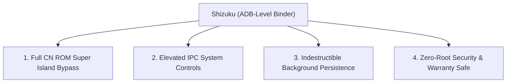

**HyperBridge is completely functional out of the box on Global and EEA ROMs without root or Shizuku.** 

However, by pairing HyperBridge with **[Shizuku](https://shizuku.rikka.app/)** (or **Sui**), the app gains access to elevated system APIs via ADB-level binder IPC. This unlocks advanced capabilities that are normally impossible for standard user applications—all without unlocking your bootloader, tripping Play Integrity, or rooting your phone.

---

## 🚀 What Shizuku Unlocks

### 1. Full HyperOS China (CN) ROM Compatibility
On Xiaomi devices running **HyperOS CN (China) ROMs**, Xiaomi enforces strict proprietary app allowlists for the Super Island. Only a handful of approved Chinese domestic apps (such as Gaode Maps, Meituan, or Ele.me) are permitted by the system framework to trigger native Focus Notifications. Standard third-party apps like Spotify, Telegram, or WhatsApp are blocked from displaying islands by default.

* **The Shizuku Workaround**: With Shizuku authorized, HyperBridge uses elevated system shell APIs to register and route notifications directly into Xiaomi's native Live Update framework, completely bypassing regional CN firmware restrictions.
* **How to enable**:
  1. Complete the [Shizuku Setup Guide]().
  2. In HyperBridge, open **Settings** &rarr; **Global Settings** &rarr; **Engine Mode**.
  3. Enable the **Shizuku / CN ROM Bypass** toggle switch.

---

### 2. Elevated IPC System Controls
Shizuku allows HyperBridge to interact directly with internal Xiaomi system packages over Android IPC (Inter-Process Communication):

* **Xiaomi Screen Recorder (`com.miui.screenrecorder`)**: Allows the Screen Recording island to execute direct system commands to pause, resume, and terminate active screen capture sessions directly from the island pill, rather than relying on awkward broadcast trampolines.
* **Network & VPN Telemetry**: Observes low-level network interface changes and VPN adapter routing tables cleanly and reliably without requiring elevated network daemon privileges.

---

### 3. System-Level Listener Persistence
One of the most common issues on aggressive OEM skins like HyperOS is the termination of background listeners when the device enters deep sleep or low-memory states.

* **Automatic Watchdog Rebinding**: When Shizuku is authorized, HyperBridge can invoke elevated system binder calls to instantly rebind and wake the Android `NotificationListenerService` if Xiaomi's task manager terminates it.
* **No Battery Overhead**: Unlike "keep-alive" battery hacks that continuously run CPU-heavy foreground loops or play silent audio, Shizuku operates strictly through event-driven binder callbacks, consuming 0% idle CPU.

---

### 4. 100% Rootless & SafetyNet / Play Integrity Safe
Because Shizuku utilizes Android’s standard developer **Wireless Debugging** interface:
* Your device does **not** need an unlocked bootloader.
* Google Play Integrity and SafetyNet pass without issues (banking and DRM-protected apps continue working normally).
* Your Xiaomi device warranty remains completely intact.

---

## ⚙️ How to Authorize HyperBridge in Shizuku

1. Follow our step-by-step [Shizuku Setup Guide]() to get the Shizuku service running via Wireless Debugging.
2. Open the **Shizuku** app on your phone.
3. Tap **Authorized applications**.
4. Locate **Hyper Bridge** in the list and switch its toggle to **Allowed**.
5. Return to **HyperBridge**; the app will automatically recognize the privileged session and enable Shizuku-powered features in settings.
